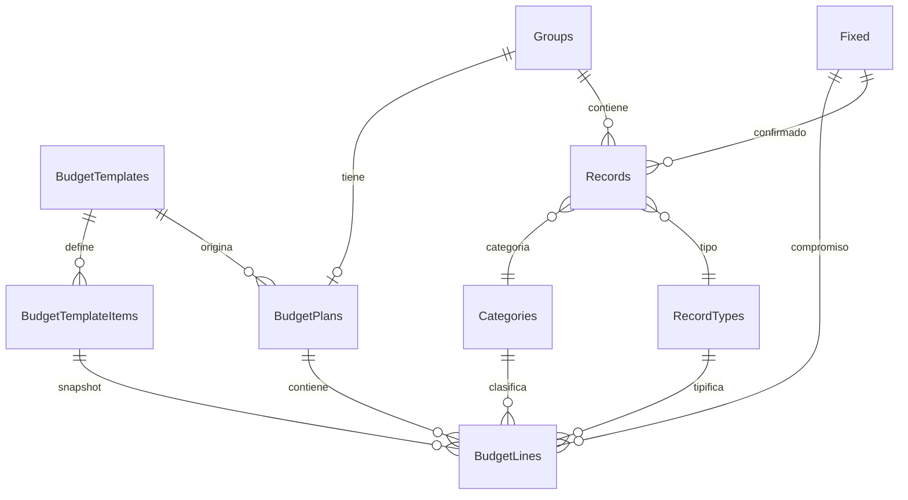

# Plan de mejora de Presupuestos — Fase 7 (BUD)

**Estado:** 📝 Planificación (pendiente de validación)
**Fecha:** 2026-10-29
**Objetivo:** terminar y publicar la sección de Presupuestos con plantillas
reutilizables, un modelo de datos que permita comparar plan vs. registros del
mes, integración con resúmenes y transacciones fijas, y gráficos construidos con
Mermaid dentro de un WebView.

> No se modificará código de la aplicación hasta validar este plan.

---

## 1. Resumen ejecutivo

La sección de presupuestos existe a medias: la ruta está oculta en el drawer, el
modelo guarda líneas sueltas sin plan padre, las plantillas no están conectadas
con los presupuestos del mes y la comparación real se calcula dentro de la UI
filtrando `records`. Además, el único componente llamado “TemplateTable” no es
una tabla de plantillas: es una copia de la tabla de registros con lógica de
fijos y créditos.

La propuesta es reemplazar el modelo plano por:

1. **`BudgetPlans`**: un plan por grupo/mes, con estado, plantilla de origen,
   umbral de alerta y notas.
2. **`BudgetLines`**: líneas del plan por categoría/tipo, con prioridad, notas y
   vínculo opcional a una transacción fija. Cada línea guarda un snapshot del
   monto planificado.
3. **Plantillas reales**: `BudgetTemplates` + `BudgetTemplateItems` mejoradas y
   conectadas mediante `template_id`/`template_item_id`.
4. **Comparación derivada**: el gasto real nunca se duplica. Se calcula en el
   repositorio desde `records` del grupo, con las mismas reglas que resúmenes.
5. **Fijos como compromisos**: las transacciones fijas alimentan el plan y se
   muestran como comprometido/pendiente/confirmado.
6. **Mermaid + WebView**: gráficos declarativos, offline, con tema claro/oscuro
   y fallback a tabla accesible.

La implementación se divide en BUD-0 a BUD-6. BUD-0 valida el plan y prueba
Mermaid offline antes de tocar el esquema.

---

## 2. Diagnóstico actual

### 2.1 La sección no está publicada

- `app/(budget)/index.tsx` existe, pero `app/_layout.tsx` oculta todo el grupo
  `(budget)` con `drawerItemStyle: { display: 'none' }`.
- `app/(budget)/BudgetTemplates.jsx` también está oculta y usa `TemplateTable`,
  que en realidad muestra registros, fijos pendientes y créditos.
- No hay una entrada de ayuda que refleje el flujo real de presupuestos; el
  tema `budgets` describe una funcionalidad que el usuario no puede usar.

### 2.2 Modelo de datos insuficiente

- `Budgets` es una tabla plana con `amount`, `group_id`, `category_id` y
  `record_type_id`. No hay entidad padre de plan, estado, prioridad, notas ni
  snapshot del origen.
- `BudgetTemplates` y `BudgetTemplateItems` existen, pero `Budgets` no tiene
  `template_id` ni `template_item_id`; no se puede saber de qué plantilla salió
  una línea.
- `BudgetTemplateItems` replica la forma de `Budgets` sin `group_id`, pero
  tampoco tiene prioridad, orden, notas ni vínculo a fijos.
- No hay restricción única por grupo/categoría/tipo; se pueden crear líneas
  duplicadas y sumar dos veces.
- No hay un plan por mes: si se quiere comparar “lo planificado” contra “lo
  real”, no existe una entidad que agrupe las líneas del mes.
- `Budgets.group_id` es nullable. Las filas huérfanas no se pueden comparar.

### 2.3 La comparación está dispersa y es inconsistente

- `src/components/budgets/budgets-table.tsx` calcula el real en la UI:
  ```ts
  records
    .filter(record =>
      record.category_id === item.category_id &&
      record.record_type_id === item.record_type_id
    )
    .reduce((total, record) => total + record.amount, 0)
  ```
- `useBudgetsRepository().getAllResume()` no lee `records`: suma los montos
  planificados de `Budgets`. La UI llama “budget” al plan y “current” al real,
  pero ambos vienen de fuentes distintas y con reglas distintas.
- `useResumesStore` calcula resúmenes con su propia lógica (tipos configurados,
  tarjetas, categorías, métodos de pago). Presupuestos no reutiliza nada de eso.
- Los registros de crédito, las transferencias y los pagos de tarjeta no tienen
  una regla explícita de inclusión en presupuestos.

### 2.4 Plantillas incompletas

- No hay pantalla real de plantillas: `BudgetTemplates.jsx` muestra registros.
- No existe “aplicar plantilla a este mes”, “guardar plan actual como
  plantilla”, “duplicar plantilla” ni “crear plan desde el mes anterior”.
- `AddTemplateItem.tsx` crea/edita **registros**, no elementos de plantilla.
- `useBudgetsRepository().fetchBudgetTemplateItems()` existe, pero no se usa en
  un flujo completo.

### 2.5 Gráficos

- No hay `victory` instalado. El único gráfico actual es `LineChart` de
  `react-native-gifted-charts` en Ahorros.
- No hay `react-native-webview` instalado.
- No existe un wrapper de gráficos reutilizable ni una estrategia offline para
  Mermaid.

### 2.6 Deuda de UI y estado

- `BudgetStore` solo expone `budgets` y `resumes`; no hay plan, líneas,
  plantillas, estado de carga ni errores.
- `budgets-table.tsx`, `add-budget.tsx`, `TemplateTable.tsx` y
  `AddTemplateItem.tsx` usan estilos legacy, `useColorStore` y lógica de negocio
  en componentes.
- La sección no usa el sistema `src/ui` de forma consistente.

---

## 3. Principios de diseño

1. **Un plan por grupo/mes.** El grupo ya representa el mes; el plan es su capa
   de planificación. Esto evita ambigüedad al comparar y permite históricos.
2. **El real se deriva, no se copia.** `BudgetLines` guarda solo lo planificado.
   El gasto real se calcula desde `Records` del mismo grupo. Nunca se duplica en
   una tabla de “ejecución”.
3. **Snapshot explícito.** El monto planificado es un snapshot editable. Si una
   plantilla o un fijo cambia después, el plan histórico no cambia solo.
4. **Líneas aditivas y sin doble conteo.** Una línea es una categoría (`scope =
   category`) o un compromiso fijo (`scope = fixed`). Los totales suman ambas,
   pero el real se asigna a una sola línea.
5. **Plantillas como planos, no como datos vivos.** Aplicar una plantilla es una
   acción explícita y transaccional con modos claros (`merge`, `replace`,
   `reset`).
6. **Fijos como compromisos.** Un fijo planifica, pero solo afecta el real
   cuando se confirma y crea un registro.
7. **Una sola regla de agregación.** Presupuestos y resúmenes comparten el mismo
   dominio de cálculo para categorías, tipos y montos.
8. **La UI consume view models.** Nada de filtros ni reducers de dinero en
   componentes. El repositorio entrega líneas comparadas, totales y alertas.
9. **Todo en centavos y timestamps.** Se mantienen las convenciones del
   proyecto.
10. **Publicar solo cuando el flujo completo funcione.** La ruta deja de estar
    oculta en BUD-6, después de migración, UI, gráficos, i18n y ayuda.

---

## 4. Modelo de datos propuesto

### 4.1 Diagrama



### 4.2 `BudgetPlans` (nueva)

Nombre lógico `BudgetPlans`, físico `budget_plans`, entidad `BudgetPlan`.

| Columna | Tipo | Notas |
| --- | --- | --- |
| `id` | INTEGER PK | autoincrement |
| `group_id` | INTEGER NOT NULL | FK `Groups` CASCADE |
| `template_id` | INTEGER | FK `BudgetTemplates` SET NULL |
| `plan_name` | TEXT | opcional; la UI genera “Octubre 2026” si falta |
| `status` | TEXT NOT NULL DEFAULT `'draft'` | `draft` / `active` / `closed` |
| `alert_threshold_percent` | INTEGER NOT NULL DEFAULT 80 | umbral de aviso por línea |
| `notes` | TEXT | notas del mes |
| `applied_template_at` | INTEGER timestamp | última aplicación de plantilla |
| `created_at`, `updated_at`, `deleted_at` | INTEGER timestamp | auditoría y soft delete |

Índices:

- único parcial `(group_id)` donde `deleted_at IS NULL`: un plan activo por mes.
- índice por `template_id` donde `deleted_at IS NULL`.

Reglas:

- Crear un plan es idempotente: si ya existe uno para el grupo, se reutiliza.
- `status = 'closed'` conserva el plan como histórico; no se borra.
- `alert_threshold_percent` se valida entre 1 y 100.

### 4.3 `BudgetLines` (nueva, reemplaza `Budgets`)

Nombre lógico `BudgetLines`, físico `budget_lines`, entidad `BudgetLine`.

| Columna | Tipo | Notas |
| --- | --- | --- |
| `id` | INTEGER PK | autoincrement |
| `budget_plan_id` | INTEGER NOT NULL | FK `BudgetPlans` CASCADE |
| `category_id` | INTEGER | FK `Categories` SET NULL |
| `record_type_id` | INTEGER | FK `RecordTypes` SET NULL |
| `fixed_id` | INTEGER | FK `Fixed` SET NULL; solo para `scope = 'fixed'` |
| `scope` | TEXT NOT NULL DEFAULT `'category'` | `category` / `fixed` |
| `source` | TEXT NOT NULL DEFAULT `'manual'` | `manual` / `template` / `fixed` / `previous_month` / `actuals` |
| `template_item_id` | INTEGER | FK `BudgetTemplateItems` SET NULL; trazabilidad |
| `planned_amount` | INTEGER money NOT NULL | snapshot en centavos |
| `priority` | INTEGER NOT NULL DEFAULT 2 | 1 alta, 2 media, 3 baja |
| `notes` | TEXT | justificación de la línea |
| `sort_order` | INTEGER NOT NULL DEFAULT 0 | orden manual |
| `created_at`, `updated_at`, `deleted_at` | INTEGER timestamp | auditoría y soft delete |

Índices:

- `(budget_plan_id)` donde `deleted_at IS NULL`.
- `(category_id)`, `(record_type_id)`, `(fixed_id)` donde `deleted_at IS NULL`.
- único parcial de categoría:
  `(budget_plan_id, category_id, record_type_id)` donde
  `deleted_at IS NULL AND scope = 'category'`
  `AND category_id IS NOT NULL AND record_type_id IS NOT NULL`.
- único parcial de fijo:
  `(budget_plan_id, fixed_id)` donde
  `deleted_at IS NULL AND scope = 'fixed' AND fixed_id IS NOT NULL`.

Invariantes:

- `scope = 'category'` exige `category_id` y `record_type_id`; `fixed_id` debe
  ser `NULL`.
- `scope = 'fixed'` exige `fixed_id`; `category_id` y `record_type_id` se copian
  del fijo como snapshot para comparar aunque el fijo cambie.
- `planned_amount > 0` (una línea en cero se elimina).
- No se puede repetir la misma categoría/tipo en el mismo plan.
- No se puede repetir el mismo fijo en el mismo plan.
- Si se elimina lógicamente un fijo, la línea permanece y se marca “fijo
  inactivo”; el snapshot no se pierde.

### 4.4 `BudgetTemplates` (existente, ampliada)

Se mantiene `template_name` y `description`. Se agrega:

| Columna | Tipo | Notas |
| --- | --- | --- |
| `is_default` | INTEGER boolean DEFAULT 0 | plantilla sugerida al crear un mes |
| `notes` | TEXT | notas de uso |

`template_name` sigue siendo único. El soft delete permite archivar plantillas
sin perder planes históricos.

Solo puede haber una plantilla predeterminada a la vez. El repositorio desmarca
la anterior y marca la nueva dentro de la misma transacción; si se archiva la
predeterminada, no se elige otra automáticamente.

### 4.5 `BudgetTemplateItems` (existente, ampliada)

Se mantiene `amount` como monto sugerido. Se agrega:

| Columna | Tipo | Notas |
| --- | --- | --- |
| `priority` | INTEGER NOT NULL DEFAULT 2 | se copia a la línea |
| `notes` | TEXT | se copia a la línea |
| `sort_order` | INTEGER NOT NULL DEFAULT 0 | orden del template |
| `fixed_id` | INTEGER | FK `Fixed` SET NULL; item que representa un fijo |
| `scope` | TEXT NOT NULL DEFAULT `'category'` | `category` / `fixed` |

Reglas:

- Un template puede tener varios items de la misma categoría si representan
  fijos distintos; el índice único se aplica por `scope` y `fixed_id`.
- Aplicar un template copia `amount`, `priority`, `notes`, `sort_order`,
  `category_id`, `record_type_id`, `fixed_id` y `scope` a la línea.
- Cambiar un template **no** modifica planes ya creados.

### 4.6 `Budgets` (legacy)

- Sale de `APP_SCHEMA` y de `TABLE_NAMES` cuando la migración esté validada.
- La migración copia sus filas a `BudgetPlans`/`BudgetLines`.
- Se conserva como `budgets_legacy` durante una versión para auditoría y se
  elimina en una migración posterior (`0005_drop_budget_legacy`).
- El código nuevo no debe importar `Budget` ni `useBudgetsRepository` legacy.

### 4.7 Por qué no se guarda el real

Guardar el real en `BudgetLines` obligaría a sincronizar cada alta, edición y
borrado de `Records`, y a decidir qué pasa con créditos, fijos y transferencias.
Derivarlo desde `Records`:

- elimina inconsistencias;
- permite corregir un registro y ver el presupuesto actualizado al instante;
- evita migraciones de datos de ejecución;
- deja una sola fuente de verdad para el dinero real.

---

## 5. Migración y compatibilidad

### 5.1 Versión

- `SCHEMA_VERSION` pasa de `3` a `4`.
- Nueva migración `src/db/migrations/0004_budget_plans.ts`.
- Regenerar artefactos con `npm run db:generate` después de editar
  `src/db/schema/tables.ts`.

### 5.2 Pasos de `0004_budget_plans`

1. Crear `budget_plans` con `createTableSql(APP_SCHEMA.BudgetPlans)`.
2. Crear `budget_lines` con `createTableSql(APP_SCHEMA.BudgetLines)`.
3. Agregar columnas nuevas a `budget_templates` y `budget_template_items` con
   `ALTER TABLE` (la migración incremental no ejecuta `ensureSchema`, así que no
   se puede confiar en el rebuild automático).
4. Copiar presupuestos existentes:
   - agrupar por `group_id` no nulo y no borrado;
   - crear un `BudgetPlan` por grupo con `status = 'active'`,
     `plan_name` generado desde `Groups.month/year`;
   - copiar cada `Budgets` a `BudgetLines` con `scope = 'category'`,
     `source = 'manual'`, `planned_amount = amount`, `priority = 2`;
   - preservar `created_at`, `updated_at` y `deleted_at`.
5. Filas con `group_id` nulo:
   - no se pueden asociar a un plan;
   - se copian a una tabla temporal de auditoría o se conservan en
     `budgets_legacy`;
   - se registra el conteo en el log de migración y en un test.
6. Renombrar `budgets` a `budgets_legacy` (sin triggers nuevos y fuera de
   `APP_SCHEMA`).
7. Crear índices únicos y triggers de auditoría para las tablas nuevas.

La migración debe ser idempotente: si se interrumpe, el runner la reintenta y
`CREATE TABLE IF NOT EXISTS` / `INSERT OR IGNORE` evitan duplicados.

### 5.3 Compatibilidad

- Un backup anterior (esquema ≤ 3) se puede importar: la importación ejecuta
  `migrateDb` y luego `0004` convierte `Budgets`.
- Un backup nuevo incluye `budget_plans` y `budget_lines`; `budgets_legacy`
  puede aparecer en el dump y se ignora en la app.
- Si un usuario tenía presupuestos duplicados, la copia puede violar el índice
  único. La migración debe resolverlo:
  - conservar la línea más reciente;
  - sumar las anteriores en `notes` o descartar duplicados con log;
  - nunca fallar por datos duplicados.
- Los planes existentes quedan en `active`; el usuario puede cerrarlos.

### 5.4 Riesgos de migración

- Pérdida de filas con `group_id` nulo: se mitiga conservando `budgets_legacy`.
- Diferencias de tipos legacy (`budget_type` textual, etc.): se reutilizan los
  helpers de `apply.ts` o se copian valores ya normalizados.
- Triggers de auditoría sobre tablas nuevas: se crean con
  `ensureTimestampTriggers` después de la migración.

---

## 6. Motor de comparación plan vs. real

### 6.1 Regla de selección de registros

El “real” de una línea se calcula con:

- `records.group_id = plan.group_id`;
- `records.deleted_at IS NULL`;
- `records.category_id` y `records.record_type_id` coinciden con la línea;
- el tipo de registro es “presupuestable”: efecto `+` o `-`, excluyendo el tipo
  configurado como `paymentCreditType` (pago de tarjeta, que no es gasto nuevo).

Reglas explícitas:

| Concepto | ¿Cuenta en presupuesto? | Motivo |
| --- | --- | --- |
| Ingreso (`effect = '+'`) | Sí, si hay línea de ingreso | Permite planificar ahorro |
| Gasto (`effect = '-'`) | Sí | Gasto real |
| Gasto a crédito | Sí, si su tipo tiene efecto `-` | Es consumo del mes |
| Pago de tarjeta (`paymentCreditType`) | No | Es liquidación, no gasto nuevo |
| Transferencia (`effect = '='`) | No | No cambia el patrimonio |
| Fijo pendiente | Se muestra aparte como compromiso | Aún no es registro |
| Fijo confirmado | Sí, vía su registro | Ya es real |

Esta regla debe vivir en `src/domain/summaries` y ser usada por resúmenes y
presupuestos. Si el usuario cambia los tipos configurados, ambos cambian igual.

### 6.2 Asignación sin doble conteo

- Si una línea es `scope = 'fixed'`, su real son los registros del grupo con
  `fixed_id = line.fixed_id`.
- Si una línea es `scope = 'category'`, su real son los registros de esa
  categoría/tipo **cuyo `fixed_id` no esté cubierto por una línea fija del mismo
  plan**.
- Los registros sin línea se agrupan en `unplanned`.
- Un registro con `fixed_id` de un fijo que no está en el plan cuenta como
  categoría (o como no planificado si no hay línea de categoría).

### 6.3 View model del repositorio

```ts
type BudgetLineComparison = {
  lineId: number;
  scope: 'category' | 'fixed';
  categoryId: number | null;
  categoryName: string;
  recordTypeId: number | null;
  typeName: string;
  effect: '+' | '-' | '=' | null;
  plannedCents: number;
  actualCents: number;
  pendingFixedCents: number;
  varianceCents: number;        // planned - actual
  usagePercent: number;         // actual / planned * 100
  projectedCents: number | null;
  status: 'on_track' | 'warning' | 'over' | 'unplanned' | 'fixed_pending';
  priority: 1 | 2 | 3;
  notes: string | null;
  fixedId: number | null;
  fixedName: string | null;
  fixedDay: number | null;
  fixedConfirmed: boolean;
};

type BudgetPlanView = {
  planId: number;
  groupId: number;
  month: number;
  year: number;
  status: 'draft' | 'active' | 'closed';
  templateId: number | null;
  alertThresholdPercent: number;
  totals: {
    plannedIncomeCents: number;
    plannedExpenseCents: number;
    actualIncomeCents: number;
    actualExpenseCents: number;
    plannedNetCents: number;
    actualNetCents: number;
    pendingFixedCents: number;
  };
  lines: BudgetLineComparison[];
  unplanned: {
    categoryId: number | null;
    categoryName: string;
    recordTypeId: number | null;
    typeName: string;
    actualCents: number;
    recordCount: number;
  }[];
  fixedCommitments: {
    fixedId: number;
    name: string;
    day: number;
    amountCents: number;
    categoryId: number | null;
    categoryName: string;
    confirmed: boolean;
    recordId: number | null;
    lineId: number | null;
  }[];
  insights: BudgetInsight[];
};
```

`BudgetInsight` es un mensaje tipado, no texto hardcodeado:

```ts
type BudgetInsight =
  | { kind: 'over_budget'; lineId: number; amountCents: number }
  | { kind: 'near_limit'; lineId: number; usagePercent: number }
  | { kind: 'unplanned_spending'; categoryId: number | null; amountCents: number }
  | { kind: 'fixed_uncovered'; fixedId: number; amountCents: number }
  | { kind: 'fixed_pending'; fixedId: number; day: number; amountCents: number }
  | { kind: 'no_plan'; groupId: number }
  | { kind: 'empty_plan'; planId: number };
```

La UI traduce cada `kind` con `t()` y muestra acciones concretas.

### 6.4 Cálculo

El repositorio puede usar `useORM('BudgetLines').raw(...)` o una consulta
tipada con `JOIN` y `GROUP BY`. Se prefiere una consulta agregada por plan para
evitar N+1:

```sql
SELECT
  l.id,
  l.scope,
  l.category_id,
  l.record_type_id,
  l.fixed_id,
  l.planned_amount,
  COALESCE(SUM(CASE
    WHEN l.scope = 'fixed' AND r.fixed_id = l.fixed_id THEN r.amount
    WHEN l.scope = 'category'
      AND r.category_id = l.category_id
      AND r.record_type_id = l.record_type_id
      AND (r.fixed_id IS NULL OR r.fixed_id NOT IN (
        SELECT fixed_id FROM budget_lines
        WHERE budget_plan_id = l.budget_plan_id
          AND scope = 'fixed'
          AND deleted_at IS NULL
          AND fixed_id IS NOT NULL
      ))
    THEN r.amount
    ELSE 0
  END), 0) AS actual_amount
FROM budget_lines l
JOIN budget_plans p ON p.id = l.budget_plan_id
LEFT JOIN records r
  ON r.group_id = p.group_id
  AND r.deleted_at IS NULL
  AND r.record_type_id = l.record_type_id
  AND r.amount > 0
WHERE l.budget_plan_id = ?
  AND l.deleted_at IS NULL
GROUP BY l.id;
```

Los tipos presupuestables se pasan como parámetros (`record_type_id IN (...)`)
para no hardcodear nombres ni IDs.

### 6.5 Fijos pendientes y proyección

- Un fijo está **confirmado** si existe un `Records` del grupo con
  `fixed_id = Fixed.id` y no borrado.
- Si no está confirmado, se muestra como `pendingFixedCents` con su día.
- `projectedCents` para una línea de categoría:
  - si el grupo es pasado: `actual`;
  - si es futuro: `planned`;
  - si es el mes actual:
    `actual + pendiente + (actualVariable / díasTranscurridos) * díasRestantes`,
    con un límite para no proyectar con muy pocos días.
- La proyección es una ayuda, no una verdad: la UI la etiqueta como
  “proyección al ritmo actual” y permite ocultarla.
- Para líneas fijas no se proyecta: se usa el monto del fijo y su estado.

### 6.6 Integración con resúmenes

- Extraer de `useResumesStore` la lógica pura a
  `src/domain/summaries/aggregate.ts`:
  - `isBudgetableRecordType`;
  - `sumByCategory`;
  - `sumByRecordType`;
  - `sumByPaymentMethod`;
  - `sumByPaymentType`;
  - `calculateBalance`.
- `useResumesStore` pasa a ser un adaptador delgado sobre esas funciones.
- Presupuestos usa las mismas funciones/consulta.
- En Resúmenes se agrega un bloque “Plan vs. real” por categoría:
  - planificado, real, variación y porcentaje;
  - enlace a la línea del presupuesto;
  - si no hay plan, enlace a “Crear plan del mes”.
- En Presupuestos se reutilizan `SummaryBlock`, `FinanceValue`,
  `SummaryGroup` y `ListItem` para mantener consistencia visual.
- Los filtros de resúmenes pueden abrir el detalle de registros de una línea.

---

## 7. Plantillas reutilizables

### 7.1 Experiencia

- Pantalla “Plantillas” con lista, búsqueda y acciones:
  - crear;
  - editar;
  - duplicar;
  - marcar como predeterminada;
  - archivar.
- Editor de plantilla:
  - nombre, descripción, notas;
  - items agrupados por tipo y categoría;
  - monto sugerido, prioridad, notas, orden;
  - vínculo opcional a una transacción fija;
  - total planificado de la plantilla.
- Acciones desde un plan:
  - “Aplicar plantilla”;
  - “Guardar plan actual como plantilla”;
  - “Crear desde el mes anterior”;
  - “Crear desde los fijos activos”;
  - “Crear desde los gastos reales del mes anterior”.

### 7.2 Modos de aplicación

| Modo | Comportamiento |
| --- | --- |
| `merge` (recomendado) | Agrega items que no existan; conserva montos editados |
| `replace` | Reemplaza todas las líneas del plan por las del template |
| `reset` | Conserva líneas, pero sobrescribe montos con los del template |

- `replace` pide confirmación y muestra cuántas líneas se eliminarán.
- `reset` pide confirmación y muestra cuántas líneas cambiarán de monto.
- Toda aplicación es una transacción: si falla, no deja el plan a medias.
- Al aplicar, se actualiza `BudgetPlans.template_id` y
  `applied_template_at`.
- Las líneas creadas guardan `source = 'template'` y `template_item_id`.

### 7.3 Deduplicación

- Un item de plantilla `scope = 'category'` se fusiona con una línea de
  categoría existente por `(category_id, record_type_id)`.
- Un item `scope = 'fixed'` se fusiona por `fixed_id`.
- Si el template tiene un item de categoría y el plan ya tiene líneas fijas de
  esa categoría, la UI advierte:
  “Esta categoría ya tiene 2 compromisos fijos. El sobre de categoría debe
  excluirlos para no duplicar.”
- La pantalla de aplicación muestra un preview antes de confirmar.

### 7.4 Guardar como plantilla

- Convierte las líneas actuales en items:
  - `scope`, `category_id`, `record_type_id`, `fixed_id`;
  - `amount = planned_amount`;
  - `priority`, `notes`, `sort_order`.
- Pide nombre y descripción; si el nombre existe, sugiere otro.
- No guarda el grupo ni el real: una plantilla es un plano reutilizable.

### 7.5 Sugerencias desde datos reales

- “Desde el mes anterior”:
  - copia las líneas del plan anterior si existe;
  - si no, usa los reales por categoría/tipo del mes anterior como sugerencia.
- “Desde los fijos activos”:
  - crea líneas `scope = 'fixed'` para cada fijo activo de tipo presupuestable;
  - omite fijos ya cubiertos por una línea del plan.
- “Desde los reales”:
  - crea líneas de categoría con `planned_amount = actual` redondeado;
  - marca `source = 'actuals'`;
  - muestra una advertencia de que es una base, no una decisión.

---

## 8. Experiencia de usuario

### 8.1 Publicación

- Quitar `drawerItemStyle: { display: 'none' }` de `(budget)` en
  `app/_layout.tsx`.
- Título: `headers.budget` (“Presupuestos”).
- Icono: `wallet-outline` o `pie-chart-outline`.
- Orden sugerido: después de Resúmenes, antes de Créditos.
- `BudgetTemplates.jsx` se reemplaza por una ruta tipada
  `app/(budget)/templates.tsx`; no se deja una pantalla duplicada.

### 8.2 Pantalla principal

`app/(budget)/index.tsx`:

- `Screen` + `GroupSelector`.
- Cabecera del plan:
  - mes/año y estado (`draft`/`active`/`closed`);
  - botón “Editar plan”;
  - menú de plantillas.
- Tarjetas de totales:
  - planificado (ingresos, gastos, neto);
  - real (ingresos, gastos, neto);
  - pendiente de fijos;
  - variación.
- Indicador de salud:
  - líneas en riesgo, excedidas y sin planificar;
  - monto excedido total;
  - próximo fijo pendiente.
- Gráfico Mermaid (ver sección 9).
- Lista de líneas:
  - categoría, tipo, prioridad;
  - planificado, real, variación, porcentaje;
  - barra de progreso;
  - estado con color semántico;
  - acciones editar/eliminar.
- Sección “Sin planificar” con registros del mes que no tienen línea.
- Sección “Compromisos fijos” con estado confirmado/pendiente y acción
  “Agregar al plan”.
- Estado vacío:
  - “Aún no hay plan para este mes”;
  - acciones: “Usar plantilla”, “Crear desde el mes anterior”, “Crear desde
    fijos”, “Empezar de cero”.

### 8.3 Editor de plan

- Formulario de línea:
  - tipo (solo tipos presupuestables);
  - categoría;
  - monto (`MoneyField`);
  - prioridad (`SelectField` o segmented);
  - notas;
  - si es fijo, selector de fijo y monto sugerido.
- Al agregar una categoría que ya tiene línea, se abre la existente en lugar de
  duplicar.
- Al agregar un fijo, se sugiere su monto y se bloquea el selector de categoría
  (se copia del fijo).
- Totales en vivo con `SummaryBlock`.
- Validación con `toast`/`InlineMessage`; nunca `Alert` directo.

### 8.4 Plantillas

- `app/(budget)/templates.tsx`: lista.
- `app/(budget)/templates/[id].tsx`: edición.
- `app/(budget)/templates/apply.tsx` o `Dialog`: preview y modo.
- Reutilizar `Screen`, `Surface`, `ListItem`, `Button`, `Dialog`,
  `ConfirmDialog`, `SelectField`, `MoneyField`, `SwitchField`.

### 8.5 Detalle de línea

- Al tocar una línea, abrir un detalle con:
  - resumen plan/real;
  - registros del mes que la componen;
  - fijos asociados;
  - botón “Ver en registros” con filtros preaplicados.
- Reutilizar el modal de filtros y el detalle de registros existente.

### 8.6 Navegación y estado

- Reemplazar `BudgetStore` por un store específico:
  - `plan`, `lines`, `templates`, `loading`, `error`;
  - acciones `loadPlan(groupId)`, `applyTemplate`, `saveLine`, `deleteLine`,
    `saveAsTemplate`.
- El store llama al repositorio; no calcula dinero.
- Mantener un adaptador temporal solo si otra pantalla importa `BudgetStore`;
  hoy solo lo usan los componentes legacy que se reemplazan.

---

## 9. Gráficos con Mermaid + WebView

### 9.1 Alcance

- Introducir Mermaid como estándar de gráficos para Presupuestos.
- No migrar Ahorros en esta fase; su `LineChart` de `gifted-charts` se queda
  como está. Se anota como seguimiento opcional.
- No se instala Victory.

### 9.2 Dependencias

- `react-native-webview` con `npx expo install react-native-webview`.
- `mermaid` como dependencia de desarrollo para generar/vendorizar el bundle.
- `expo-asset` y `expo-file-system` ya están disponibles vía Expo; confirmar
  versiones compatibles.

### 9.3 Estrategia offline

1. Fijar una versión de Mermaid (por ejemplo `11.x`) y generar
   `assets/vendor/mermaid.min.js` con un script reproducible
   (`scripts/vendor-mermaid.js`).
2. Guardar también la licencia y la versión en `assets/vendor/mermaid/README.md`.
3. En runtime:
   - `Asset.fromModule(require('.../mermaid.min.js')).downloadAsync()`;
   - leer el archivo con `expo-file-system`;
   - inyectarlo en el HTML del WebView dentro de `<script>...</script>`.
4. No usar CDN, `unpkg` ni red. La app debe renderizar en modo avión.
5. Si el asset no se puede leer, mostrar el fallback de tabla y un
   `InlineMessage` de error; nunca dejar un WebView en blanco.

### 9.4 Componente `MermaidChart`

`src/ui/charts/MermaidChart.tsx`:

- Props:
  - `definition: string`;
  - `height?: number`;
  - `accessibilityLabel: string`;
  - `fallback: React.ReactNode`;
  - `onError?: () => void`.
- Estado:
  - `html` memoizado;
  - `status: 'loading' | 'ready' | 'error'`;
  - `themeKey` para recargar al cambiar tema.
- WebView:
  - `originWhitelist={['about:blank']}`;
  - `javaScriptEnabled`;
  - `domStorageEnabled={false}`;
  - `scrollEnabled={false}`;
  - `onShouldStartLoadWithRequest` bloquea navegación externa;
  - CSP restrictiva;
  - `onMessage` para errores de Mermaid y altura.
- Tema:
  - `themeVariables` con `background`, `primaryTextColor`, `lineColor`,
    `primaryColor`, `secondaryColor`, `tertiaryColor`;
  - colores de gasto/ingreso desde `useTheme()`;
  - fondo transparente o `colors.surface`.
- Accesibilidad:
  - el WebView no es accesible por sí solo;
  - siempre renderizar debajo una tabla/resumen textual;
  - `accessibilityLabel` con totales y estado;
  - botón “Ver datos” que expande la tabla.
- Rendimiento:
  - memoizar el HTML;
  - limitar a top 8 categorías + “Otras”;
  - altura calculada;
  - cargar el bundle una sola vez y cachear el string en memoria.

### 9.5 Gráficos propuestos

1. **Salud del plan (pie)**
   - “Dentro del plan”, “Cerca del límite”, “Excedido”, “Sin planificar”.
   - Útil para una lectura inmediata.

2. **Plan vs. real por categoría (`xychart-beta` de barras)**
   - eje X: categorías top N;
   - series: planificado y real;
   - si Mermaid no soporta dos series de barras en la versión elegida, usar
     dos gráficos o `quadrantChart` como alternativa.

3. **Distribución del plan (pie)**
   - participación de cada categoría en el total planificado.

4. **Proyección (opcional, `xychart-beta` de línea)**
   - real acumulado vs. proyección al cierre;
   - solo para el mes actual.

### 9.6 Construcción segura de Mermaid

- `src/domain/budgets/charts.ts` expone funciones puras:
  - `buildBudgetHealthPie(view)`;
  - `buildBudgetComparisonChart(view)`;
  - `buildBudgetDistributionPie(view)`;
  - `buildBudgetProjectionChart(view)`.
- Reglas:
  - sanear etiquetas: quitar `"`, `[]`, `()`, `{}`, saltos de línea y
    caracteres de control;
  - truncar a 24 caracteres;
  - usar IDs estables, no nombres de categoría;
  - escapar montos y porcentajes;
  - si no hay datos, devolver `null` y la UI muestra `EmptyState`.
- Tests unitarios de los strings generados; no tests de render de WebView.

### 9.7 Web y Expo Go

- `react-native-webview` no funciona igual en web. En web:
  - usar el fallback de tabla o un SVG estático;
  - detectar con `Platform.OS === 'web'`.
- En Expo Go, validar que el WebView cargue el asset local; si no, usar un
  development build.
- Probar en Android e iOS; el proyecto se distribuye principalmente en Android.

### 9.8 Spike BUD-0

Antes de implementar la UI:

- crear una pantalla de prueba temporal (no publicada) con un `WebView` y
  Mermaid vendorizado;
- validar:
  - render offline;
  - pie;
  - `xychart-beta` con una y dos series;
  - tema claro/oscuro;
  - tamaño y scroll;
  - errores y fallback;
  - consumo de memoria al abrir/cerrar.
- Si Mermaid no cumple, el plan alternativo es generar SVG propio o usar
  `react-native-svg`; no se instala Victory.

---

## 10. Integración con resúmenes y fijos

### 10.1 Resúmenes

- Nuevo bloque en `app/(summaries)/index.tsx` o en la pantalla de categorías:
  “Presupuesto del mes”.
- Cada fila de categoría muestra:
  - planificado;
  - real;
  - variación;
  - porcentaje;
  - estado.
- Acción “Ver plan” navega a la línea correspondiente.
- Si no hay plan, acción “Crear plan del mes”.
- El bloque usa el mismo `BudgetPlanView` que Presupuestos para no duplicar
  cálculos.

### 10.2 Fijos

- En Presupuestos:
  - sección de compromisos fijos con día, monto, categoría y estado;
  - “Agregar al plan” crea una línea `scope = 'fixed'`;
  - “Quitar del plan” elimina la línea, no el fijo;
  - “Sincronizar monto” actualiza el snapshot desde el fijo, con confirmación.
- En Fijos:
  - indicador “Incluido en el plan de <mes>”;
  - si no está incluido, acción “Agregar al presupuesto”;
  - al confirmar un fijo, el registro aparece como real en el plan.
- Al cambiar el monto de un fijo:
  - los planes históricos no cambian;
  - el plan actual muestra “monto desactualizado” y ofrece sincronizar.
- Al eliminar un fijo:
  - la línea permanece como “fijo inactivo”;
  - el usuario puede eliminarla o convertirla en línea de categoría.

### 10.3 Registros

- Un registro nuevo o editado actualiza el real automáticamente.
- El detalle de la línea muestra los registros que la componen.
- “Ver en registros” aplica filtros por grupo, categoría y tipo.
- Si un registro cambia de categoría/tipo, se mueve de línea sin intervención.

---

## 11. Traducciones y ayuda

### 11.1 Traducciones

- Nuevo dominio `src/lang/messages/budget.ts` con inglés y español.
- Claves mínimas:
  - `budget.plan.*`: título, estado, acciones, totales;
  - `budget.line.*`: campos, prioridad, notas, estados;
  - `budget.template.*`: lista, editor, modos, confirmaciones;
  - `budget.fixed.*`: compromiso, pendiente, confirmado, sincronizar;
  - `budget.insight.*`: cada `kind`;
  - `budget.chart.*`: títulos, series, sin datos, error;
  - `budget.empty.*`: estados vacíos;
  - `budget.confirm.*`: eliminar, reemplazar, resetear.
- Agregar `TranslationKey` al dominio y helpers si hay claves dinámicas.
- No dejar texto hardcodeado en componentes.

### 11.2 Ayuda

- Actualizar el tema `budgets` de `src/lang/messages/help.ts`:
  - qué es un plan;
  - diferencia plan/real;
  - plantillas;
  - fijos como compromisos;
  - gráficos y proyección;
  - ejemplo con datos ficticios.
- Agregar tema `budgetTemplates` si el editor lo amerita.
- Actualizar `src/help/types.ts` y `src/help/registry.ts`.
- Actualizar `AGENTS.md` si cambia el flujo de mantenimiento.
- Ejecutar `src/help/__tests__/registry.test.ts` y
  `src/lang/__tests__/messages.test.ts`.

---

## 12. Pruebas y criterios de aceptación

### 12.1 Base de datos

- `npm run test:db` debe cubrir:
  - migración de `Budgets` a `BudgetPlans`/`BudgetLines`;
  - preservación de montos, categorías, tipos y timestamps;
  - filas con `group_id` nulo;
  - duplicados legacy;
  - idempotencia de la migración;
  - índices únicos;
  - triggers de auditoría;
  - borrado en cascada de plan → líneas;
  - `fixed_id` con `SET NULL`;
  - soft delete.
- `npm run db:generate` sin cambios pendientes después de editar el esquema.

### 12.2 Dominio y repositorios

- Tests de:
  - comparación por categoría/tipo;
  - exclusión de pagos de tarjeta y transferencias;
  - inclusión de gastos a crédito según la regla acordada;
  - asignación de fijos;
  - fijos pendientes y confirmados;
  - líneas sin planificar;
  - proyección;
  - plantilla `merge`/`replace`/`reset`;
  - deduplicación;
  - “guardar como plantilla”;
  - “desde el mes anterior”;
  - “desde fijos activos”.
- Los tests usan `node:sqlite` como el resto de `test:db` cuando tocan SQL.

### 12.3 UI

- Tests unitarios de funciones puras y helpers de estado.
- Pruebas de componentes donde aporten valor:
  - estado vacío;
  - fila con estado `over`;
  - diálogo de aplicar plantilla;
  - fallback de gráfico.
- No snapshot de WebView.

### 12.4 Manual

- Android (prioritario) e iOS si hay build.
- Modo claro y oscuro.
- Textos largos y fuente grande.
- Grupo sin plan, con plan vacío, con plan completo, con plan excedido.
- Mes pasado, mes actual y mes futuro.
- Modo avión para Mermaid.
- Rotación y tamaños de pantalla.
- Import/export de backup antes y después de la migración.

### 12.5 Criterios de aceptación de la fase

- La sección aparece en el drawer y es navegable.
- Existe un plan por grupo y no se pueden duplicar líneas.
- Las plantillas se crean, editan, aplican y guardan como plantilla.
- La comparación plan/real coincide con los resúmenes para las mismas reglas.
- Los fijos pendientes y confirmados se muestran correctamente.
- Los gráficos Mermaid renderizan offline, con tema y fallback.
- La migración preserva datos y es reversible vía backup.
- `npm run ci` y `npm run lint` pasan.
- La ayuda y las traducciones están actualizadas.
- No queda código legacy de presupuestos en uso.

---

## 13. Fases de ejecución

### BUD-0 — Validación y spike (sin código de producto)

- Validar este plan y resolver las decisiones abiertas.
- Confirmar reglas de inclusión (crédito, ingresos, transferencias).
- Spike de Mermaid + WebView offline.
- Medir bundle, tiempos de render y memoria.
- Definir la versión de Mermaid y el script de vendorizado.

**Salida:** decisiones cerradas + prototipo de gráfico descartable.

### BUD-1 — Esquema y migración

- Editar `src/db/schema/tables.ts`:
  - agregar `BudgetPlans`, `BudgetLines`;
  - ampliar `BudgetTemplates`, `BudgetTemplateItems`;
  - retirar `Budgets` del esquema activo.
- `SCHEMA_VERSION = 4`.
- Crear `0004_budget_plans.ts`.
- Actualizar `src/validation/entities.ts` con zod.
- Regenerar artefactos y `docs/schema.md`.
- Tests de migración y datos.

**Salida:** esquema nuevo, migración probada, sin UI nueva.

### BUD-2 — Dominio y repositorios

- `src/domain/summaries/aggregate.ts` con reglas compartidas.
- `src/domain/budgets/` con:
  - comparación;
  - estados;
  - proyección;
  - insights;
  - deduplicación.
- `useBudgetPlansRepository` / `useBudgetTemplatesRepository`:
  - `getPlanView(groupId)`;
  - `createPlan`;
  - `saveLine`;
  - `deleteLine`;
  - `applyTemplate`;
  - `saveAsTemplate`;
  - `createFromPreviousMonth`;
  - `createFromFixeds`;
  - `createFromActuals`.
- Tests de dominio y SQL.

**Salida:** view model completo y testeado, sin pantallas.

### BUD-3 — Plantillas

- Pantalla de lista y editor de plantillas.
- Item editor con prioridad, notas, orden y fijo opcional.
- Diálogo de aplicación con preview y modos.
- “Guardar plan actual como plantilla”.
- Tests de flujos.

**Salida:** plantillas reutilizables de punta a punta.

### BUD-4 — Pantalla de presupuestos

- Reescribir `app/(budget)/index.tsx` y componentes en
  `src/components/budgets/`.
- Editor de plan, detalle de línea, estados vacíos.
- Sección de fijos y sin planificar.
- Integración con resúmenes.
- Reemplazar `BudgetStore` por el store nuevo.
- Eliminar `budgets-table.tsx`, `add-budget.tsx`, `TemplateTable.tsx`,
  `AddTemplateItem.tsx` cuando ya no se usen.

**Salida:** flujo completo usable, todavía sin publicar.

### BUD-5 — Gráficos Mermaid

- `react-native-webview` + Mermaid vendorizado.
- `MermaidChart` con tema, accesibilidad y fallback.
- Gráficos de salud, comparación, distribución y proyección.
- Tests de builders y QA visual.

**Salida:** gráficos offline integrados.

### BUD-6 — Publicación, ayuda y cierre

- Quitar `display: 'none'` del drawer.
- Traducciones `budget` y ayuda actualizada.
- Documentación (`docs/phases.md`, `docs/database.md`, `AGENTS.md`).
- QA final Android/iOS/web.
- Migración de limpieza `0005_drop_budget_legacy` si los datos están validados.
- Marcar Fase 7 como finalizada.

**Salida:** sección publicada y documentada.

---

## 14. Riesgos y mitigaciones

| Riesgo | Impacto | Mitigación |
| --- | --- | --- |
| Mermaid no renderiza `xychart-beta` con dos series | Medio | Spike BUD-0; alternativa con dos gráficos o SVG |
| Bundle de Mermaid grande | Medio | Vendorizar, cargar solo al abrir presupuestos, cachear |
| WebView no funciona en web | Medio | Fallback de tabla/SVG; detectar plataforma |
| Migración con datos duplicados o huérfanos | Alto | Copia defensiva, `budgets_legacy`, tests con datos sucios |
| Doble conteo fijo/categoría | Alto | `scope`, asignación exclusiva, preview y tests |
| Reglas de crédito distintas entre resúmenes y presupuestos | Alto | Dominio compartido y tests de paridad |
| Cambios de plantilla alteran planes históricos | Medio | Snapshot y copia explícita |
| Falta de tiempo para publicar | Medio | BUD-6 separado; no publicar hasta cumplir criterios |
| Categorías/tipos borrados | Bajo | Soft delete y `SET NULL`; mostrar “sin categoría” |

---

## 15. Decisiones abiertas para validar

1. **¿Un plan por mes o varios escenarios?**
   - Recomendado: uno por mes. Escenarios quedan para una fase futura.
2. **¿Los gastos a crédito cuentan en el presupuesto?**
   - Recomendado: sí, porque son consumo del mes; los pagos de tarjeta no.
3. **¿Las líneas fijas son líneas separadas o parte del sobre de categoría?**
   - Recomendado: separadas (`scope = 'fixed'`) para ver compromisos, con
     advertencia para no duplicar.
4. **¿Se planifican ingresos además de gastos?**
   - Recomendado: sí, opcional; el plan muestra neto.
5. **¿Mermaid solo en Presupuestos o también en Ahorros?**
   - Recomendado: solo Presupuestos ahora; Ahorros en una fase posterior.
6. **¿Modo de aplicación por defecto?**
   - Recomendado: `merge`.
7. **¿Prioridad de 3 niveles o esencial/no esencial?**
   - Recomendado: 3 niveles (`alta`, `media`, `baja`) para ordenar decisiones.

---

## 16. Archivos previstos

### Esquema y datos

- `src/db/schema/tables.ts`
- `src/db/migrations/0004_budget_plans.ts`
- `src/db/migrations/0005_drop_budget_legacy.ts` (posterior)
- `src/db/migrations/index.ts`
- `src/db/schema/generated/*` (generado)
- `src/validation/entities.ts`
- `src/db/repositories/index.ts` o nuevos repositorios por agregado
- `docs/schema.md`, `docs/database.md`

### Dominio

- `src/domain/summaries/aggregate.ts`
- `src/domain/budgets/comparison.ts`
- `src/domain/budgets/status.ts`
- `src/domain/budgets/projection.ts`
- `src/domain/budgets/charts.ts`
- `src/domain/budgets/__tests__/*`

### Estado y UI

- `src/stores/BudgetStore.ts` → reemplazo
- `app/(budget)/index.tsx`
- `app/(budget)/templates.tsx`
- `app/(budget)/templates/[id].tsx`
- `src/components/budgets/*`
- `src/ui/charts/MermaidChart.tsx`
- `src/ui/charts/index.ts`
- `app/_layout.tsx`
- `app/(summaries)/index.tsx`
- `src/components/summaries/FinanceTableBlock.tsx`

### i18n y ayuda

- `src/lang/messages/budget.ts`
- `src/lang/messages/index.ts`
- `src/lang/keys.ts`
- `src/lang/messages/help.ts`
- `src/help/types.ts`
- `src/help/registry.ts`
- `src/help/__tests__/registry.test.ts`
- `AGENTS.md`

### Assets y scripts

- `assets/vendor/mermaid/mermaid.min.js`
- `assets/vendor/mermaid/README.md` (versión y licencia)
- `scripts/vendor-mermaid.js`
- `package.json`, `package-lock.json`

---

## 17. Comandos de verificación

```bash
npm run typecheck
npm run db:generate
npm run test:db
npm test
npm run lint
npm run ci
```

Además:

- exportar/importar un backup antes y después de la migración;
- probar en modo avión;
- probar en Android físico;
- revisar contraste en claro/oscuro;
- revisar que la sección de ayuda abra desde el drawer.

---

## 18. Resultado esperado

Al cerrar la Fase 7, el usuario podrá:

1. Abrir Presupuestos desde el drawer.
2. Crear un plan mensual desde cero, desde una plantilla, desde el mes anterior
   o desde sus fijos.
3. Editar montos, prioridades y notas por categoría.
4. Ver plan vs. real, variación, porcentaje y proyección.
5. Detectar gastos sin planificar y fijos pendientes.
6. Guardar el plan como plantilla para el próximo mes.
7. Revisar el presupuesto también desde Resúmenes.
8. Entender el flujo en el centro de ayuda.

Todo con datos locales, sin dependencia de red, con migración preservando la
información existente y con una única fuente de verdad para el dinero real.
