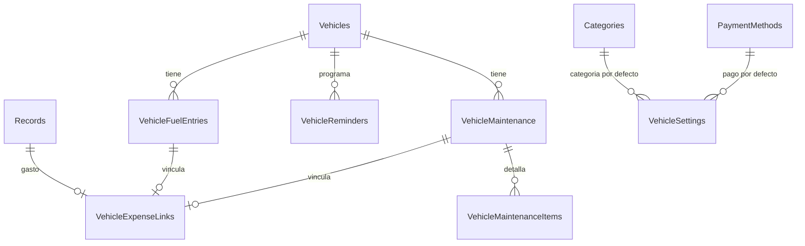

# Plan de la sección Vehículo — Fase 8 (VEH)

**Estado:** 🚧 En implementación
**Fecha:** 2026-10-30
**Objetivo:** convertir la sección Vehículo, hoy oculta y vacía, en un módulo
funcional para registrar combustible y mantenimiento, calcular consumo y
rendimiento con unidades configurables, mostrar estadísticas e históricos,
gestionar recordatorios como el cambio de aceite e integrar los gastos con
Registros.

> No se modificará código de la aplicación hasta validar este plan.

---

## 1. Resumen ejecutivo

La sección existe solo como rutas de prueba (`app/(vehicle)/index.tsx` y
`app/(vehicle)/FuelScreen.tsx` muestran “Hola”), está oculta en el drawer y no
tiene una UI ni un repositorio conectados. Las tablas actuales `FuelRefills` y
`TripLogs` no cubren lo que se necesita:

- `FuelRefills` asume galones, precio por galón y un odómetro sin unidad.
- `TripLogs` depende del reinicio del marcador de viaje, justo el mecanismo que
  se quiere eliminar.
- Ninguna de las dos tiene vehículo, vínculo con `Records`, mantenimiento ni
  recordatorios.

Como no hay datos de usuarios en esas tablas, la propuesta es reemplazarlas por
un modelo normalizado:

1. `Vehicles`.
2. `VehicleFuelEntries`.
3. `VehicleMaintenance`.
4. `VehicleMaintenanceItems`.
5. `VehicleReminders`.
6. `VehicleSettings`.
7. `VehicleExpenseLinks`.

La sección permitirá:

- Gestionar varios vehículos con uno predeterminado.
- Registrar compras de combustible con galones o litros, millas o kilómetros.
- Ingresar dos de tres valores (`volumen`, `precio por unidad`, `total`) y
  calcular el tercero.
- Usar el odómetro real, inferir la distancia y permitir distancia directa como
  alternativa.
- Ver el consumo en todas las combinaciones solicitadas: `mi/gal`, `km/gal`,
  `mi/L`, `km/L`, `L/100 km`, `gal/100 km`, `L/60 mi` y `gal/60 mi`.
- Registrar mantenimiento, piezas y servicios con una tabla de piezas flexible.
- Configurar en Ajustes qué categoría representa gasolina, mantenimiento,
  reparación y otros servicios.
- Programar cambios de aceite, rotación de llantas, filtros, frenos,
  inspección, seguro y otros recordatorios.
- Inferir el odómetro actual desde los registros de combustible/mantenimiento
  para calcular cuánto falta para el próximo servicio.
- Crear automáticamente el gasto en `Records` por defecto, vincular un gasto ya
  registrado o no vincular ninguno, sin doble captura.
- Ver históricos, comparativas por periodo y por vehículo, y gráficos Mermaid
  con colores del tema.
- Empezar solo con gasolina, dejando preparado el modelo para eléctrico,
  híbrido enchufable y propano en una fase futura.

---

## 2. Diagnóstico actual

### 2.1 La sección no está publicada

- `app/_layout.tsx` oculta `(vehicle)` con `drawerItemStyle: { display: 'none' }`.
- El título del drawer usa `headers.financialsIndex` en vez de un título de
  vehículo.
- `app/(vehicle)/_layout.tsx` usa `StackBase` con dos tabs, pero el tab
  `index` tiene título “Resumen” y el tab `FuelScreen` usa `t('vehicle')` desde
  la raíz, no desde `headers`.
- `app/(vehicle)/index.tsx` y `FuelScreen.tsx` solo renderizan “Hola”.

### 2.2 Esquema actual

`FuelRefills`:

- `date`, `odometer_reading`, `total_cost`, `gallons`, `price_per_gallon`,
  `is_full_tank`, `notes`.
- No tiene vehículo, unidad de distancia, unidad de volumen, estación,
  vínculo con `Records`, ni precio por litro.
- `fuel.ts` calcula `km_per_gallon`, `km_per_liter` y `cost_per_km` usando
  conversiones fijas y asume que el odómetro está en km.
- Los bloques de consumo se agrupan por `is_full_tank`, pero no hay soporte para
  entradas parciales, distancia ingresada directamente ni unidades del usuario.

`TripLogs`:

- `distance_traveled`, `average_consumption`, `is_counter_reset`, `trip_type`,
  `notes`.
- Está diseñado para el marcador de viaje que se reinicia. El requerimiento
  actual es usar el odómetro real, así que este modelo queda obsoleto.

### 2.3 Repositorio y datos

- `src/db/repositories/fuel.ts` contiene SQL directo con nombres y unidades
  fijas.
- `src/db/index.ts` expone `useFuelRepository`, pero no hay pantallas que lo
  usen.
- No hay seed de vehículos ni de datos de combustible.
- No hay integración con `Records`.

### 2.4 Conclusión

No conviene reutilizar `FuelRefills`/`TripLogs` con parches:

- habría que renombrar y reinterpretar columnas ambiguas;
- el modelo seguiría sin vehículo ni vínculo con gastos;
- `TripLogs` contradice el enfoque de odómetro real;
- no hay datos que justifiquen preservar esas tablas.

**Decisión propuesta:** eliminarlas y crear un modelo nuevo, manteniendo una
migración explícita y testeada.

---

## 3. Alcance y principios

### 3.1 Alcance

Incluido en la Fase 8:

- Vehículo(s), con predeterminado.
- Combustible de gasolina.
- Mantenimiento, piezas y servicios.
- Recordatorios y cambio de aceite.
- Categorías por defecto configurables.
- Estadísticas, históricos y comparativas.
- Integración con Registros.
- Publicación en el drawer.
- Traducciones, ayuda y documentación.

Fuera de alcance en la primera versión:

- GPS o seguimiento en tiempo real.
- Telemetría OBD-II.
- Carga de fotos/recibos.
- Facturación multi-moneda.
- Eléctrico, híbrido enchufable y propano (se dejan preparados `fuel_type` y
  la UI para una fase futura).
- Gestión avanzada de juegos de llantas con profundidad de dibujo.

### 3.2 Principios

1. **Unidades explícitas.** Toda entrada guarda si usa `mi`/`km` y `gal`/`L`.
   Nunca se asume una unidad.
2. **Dos de tres.** Volumen, precio por unidad y total: el usuario ingresa dos y
   la app calcula el tercero.
3. **Odómetro real.** La fuente principal es el odómetro; la distancia
   recorrida es una alternativa explícita.
4. **Cálculo puro y testeable.** Conversiones, consumo, promedios y
   recordatorios viven en `src/domain/vehicle`, no en componentes.
5. **Registros como fuente financiera.** El gasto se refleja en `Records`; la
   entrada de vehículo guarda el detalle técnico y el vínculo.
6. **Sin doble captura.** Crear una entrada de combustible o mantenimiento
   puede crear el gasto en la misma transacción.
7. **Varios vehículos con predeterminado.** Cada entrada pertenece a un
   vehículo; el predeterminado se usa al abrir la sección.
8. **Recordatorios inferidos.** El odómetro actual sale de las entradas más
   recientes; el aceite y otros servicios se calculan desde el último servicio.
9. **Categorías configurables.** El usuario decide qué categoría de Registros
   representa gasolina, mantenimiento, reparación y otros servicios.
10. **Piezas flexibles.** Las piezas se guardan como líneas con nombre, notas y
    datos opcionales; no se obliga a una cantidad fija (1, 4, etc.).
11. **Colores del tema.** Los gráficos usan tokens editables, no colores
    hardcodeados.
12. **Android/iOS.** Web queda fuera de alcance, igual que el resto de la app.

---

## 4. Modelo de datos propuesto

### 4.1 Diagrama



### 4.2 `Vehicles`

Nombre lógico `Vehicles`, físico `vehicles`, entidad `Vehicle`.

| Columna | Tipo | Notas |
| --- | --- | --- |
| `id` | INTEGER PK | autoincrement |
| `name` | TEXT NOT NULL | “Mi carro”, “Camioneta” |
| `make` | TEXT | marca |
| `model` | TEXT | modelo |
| `year` | INTEGER | año |
| `plate` | TEXT | placa |
| `color` | TEXT | color |
| `fuel_type` | TEXT NOT NULL DEFAULT `'gasoline'` | v1: `gasoline`; futuro: `electric`, `plug_in_hybrid`, `propane`, `diesel` |
| `distance_unit` | TEXT NOT NULL DEFAULT `'mi'` | `mi` / `km` |
| `volume_unit` | TEXT NOT NULL DEFAULT `'gal'` | `gal` / `L` |
| `tank_capacity` | REAL | capacidad opcional |
| `tank_capacity_unit` | TEXT | `gal` / `L` |
| `is_default` | INTEGER boolean DEFAULT 0 | vehículo inicial |
| `notes` | TEXT | notas |
| `created_at`, `updated_at`, `deleted_at` | INTEGER timestamp | auditoría y soft delete |

Reglas:

- Solo un vehículo predeterminado a la vez; el repositorio desmarca el anterior
  en la misma transacción.
- `distance_unit` y `volume_unit` son valores por defecto para nuevas entradas,
  no una restricción: cada entrada puede usar otra unidad.
- En la v1 el único tipo habilitado es gasolina. El campo `fuel_type` queda
  preparado para eléctrico, híbrido enchufable, propano y diésel, pero esos
  flujos no se implementan todavía.

### 4.3 `VehicleFuelEntries`

Nombre lógico `VehicleFuelEntries`, físico `vehicle_fuel_entries`, entidad
`VehicleFuelEntry`.

| Columna | Tipo | Notas |
| --- | --- | --- |
| `id` | INTEGER PK | autoincrement |
| `vehicle_id` | INTEGER NOT NULL | FK `Vehicles` CASCADE |
| `date` | INTEGER timestamp NOT NULL | fecha de la compra |
| `odometer` | REAL | lectura del odómetro real o inferida |
| `odometer_source` | TEXT | `manual` / `inferred` |
| `distance_unit` | TEXT NOT NULL DEFAULT `'mi'` | unidad de `odometer`/`distance` |
| `distance_traveled` | REAL | alternativa si no se ingresa odómetro |
| `distance_source` | TEXT | `odometer` / `manual` / `inferred` |
| `volume` | REAL NOT NULL | galones o litros |
| `volume_unit` | TEXT NOT NULL DEFAULT `'gal'` | `gal` / `L` |
| `price_per_unit` | INTEGER money NOT NULL | centavos por galón/litro |
| `total_cost` | INTEGER money NOT NULL | centavos |
| `is_full_tank` | INTEGER boolean NOT NULL DEFAULT 1 | tanque lleno |
| `station` | TEXT | estación opcional |
| `notes` | TEXT | notas |
| `created_at`, `updated_at`, `deleted_at` | INTEGER timestamp | auditoría y soft delete |

Índices:

- `(vehicle_id, date)` donde `deleted_at IS NULL`.
- `(vehicle_id, odometer)` donde `deleted_at IS NULL`.

Reglas:

- `volume > 0`, `price_per_unit > 0`, `total_cost > 0`.
- Al menos uno de `odometer` o `distance_traveled` debe existir.
- Si existen ambos, se valida que la diferencia con la entrada anterior sea
  coherente; si no, se muestra una advertencia y se permite corregir.
- `odometer_source = inferred` cuando se calcula desde el odómetro anterior +
  distancia; la UI lo marca como inferido.
- `distance_source = inferred` cuando se calcula desde la diferencia de
  odómetros.
- `price_per_unit` se guarda en centavos y en la unidad de `volume_unit`.
- La entrada no duplica el gasto: el vínculo financiero vive en
  `VehicleExpenseLinks`.

### 4.4 `VehicleMaintenance`

Nombre lógico `VehicleMaintenance`, físico `vehicle_maintenance`, entidad
`VehicleMaintenanceEntry`.

| Columna | Tipo | Notas |
| --- | --- | --- |
| `id` | INTEGER PK | autoincrement |
| `vehicle_id` | INTEGER NOT NULL | FK `Vehicles` CASCADE |
| `date` | INTEGER timestamp NOT NULL | fecha del servicio |
| `odometer` | REAL | odómetro al momento del servicio |
| `distance_unit` | TEXT NOT NULL DEFAULT `'mi'` | unidad |
| `service_type` | TEXT NOT NULL | `oil_change`, `tires`, `brakes`, `battery`, `filter`, `inspection`, `repair`, `other` |
| `title` | TEXT NOT NULL | descripción corta |
| `cost` | INTEGER money NOT NULL DEFAULT 0 | centavos |
| `vendor` | TEXT | taller/proveedor |
| `notes` | TEXT | piezas, detalles o factura |
| `created_at`, `updated_at`, `deleted_at` | INTEGER timestamp | auditoría y soft delete |

Índices:

- `(vehicle_id, date)` donde `deleted_at IS NULL`.
- `(vehicle_id, service_type)` donde `deleted_at IS NULL`.

Reglas:

- `cost` puede ser 0 para servicios gratuitos o garantía.
- `title` es obligatorio; `service_type` clasifica para estadísticas y
  recordatorios.
- Si `service_type = 'oil_change'`, el repositorio actualiza el recordatorio de
  aceite correspondiente.
- El costo total del servicio vive en `VehicleMaintenance.cost`; las piezas
  pueden desglosarse en `VehicleMaintenanceItems`.
- El vínculo financiero vive en `VehicleExpenseLinks`.

### 4.5 `VehicleMaintenanceItems`

Nombre lógico `VehicleMaintenanceItems`, físico `vehicle_maintenance_items`,
entidad `VehicleMaintenanceItem`.

| Columna | Tipo | Notas |
| --- | --- | --- |
| `id` | INTEGER PK | autoincrement |
| `maintenance_id` | INTEGER NOT NULL | FK `VehicleMaintenance` CASCADE |
| `name` | TEXT NOT NULL | “Llanta”, “Filtro”, “Batería” |
| `notes` | TEXT | medida, marca, detalle libre |
| `quantity` | REAL | opcional; no se obliga a 1 ni a 4 |
| `unit` | TEXT | opcional: unidad, juego, litro |
| `cost` | INTEGER money | opcional, para desglose |
| `created_at`, `updated_at`, `deleted_at` | INTEGER timestamp | auditoría y soft delete |

Reglas:

- La cantidad no es obligatoria: si el usuario cambió “llantas” y no quiere
  registrar si fueron 2 o 4, puede dejar `quantity` vacío y explicarlo en
  `notes`.
- El costo del mantenimiento sigue siendo el total; los costos de piezas son
  opcionales y no se suman automáticamente sin confirmación.
- Las piezas se editan junto con el mantenimiento.

### 4.6 `VehicleReminders`

Nombre lógico `VehicleReminders`, físico `vehicle_reminders`, entidad
`VehicleReminder`.

| Columna | Tipo | Notas |
| --- | --- | --- |
| `id` | INTEGER PK | autoincrement |
| `vehicle_id` | INTEGER NOT NULL | FK `Vehicles` CASCADE |
| `service_type` | TEXT NOT NULL | `oil_change`, `tire_rotation`, `air_filter`, `brake_fluid`, `inspection`, `insurance`, `other` |
| `title` | TEXT NOT NULL | “Cambio de aceite” |
| `interval_distance` | REAL | intervalo opcional |
| `interval_distance_unit` | TEXT | `mi` / `km` |
| `interval_months` | INTEGER | intervalo opcional |
| `last_service_date` | INTEGER timestamp | último servicio |
| `last_service_odometer` | REAL | odómetro del último servicio |
| `odometer_unit` | TEXT | unidad del odómetro anterior |
| `next_due_date` | INTEGER timestamp | fecha calculada |
| `next_due_odometer` | REAL | odómetro calculado |
| `is_active` | INTEGER boolean DEFAULT 1 | activo |
| `notes` | TEXT | notas |
| `created_at`, `updated_at`, `deleted_at` | INTEGER timestamp | auditoría y soft delete |

Reglas:

- Al menos uno de `interval_distance` o `interval_months` debe existir.
- `next_due_odometer = last_service_odometer + interval_distance` en la misma
  unidad.
- `next_due_date = last_service_date + interval_months`.
- El odómetro actual se obtiene del máximo entre `VehicleFuelEntries.odometer` y
  `VehicleMaintenance.odometer`.
- Estado:
  - `overdue` si ya pasó la fecha o el odómetro.
  - `due_soon` si queda menos del 10 % del intervalo o menos de 30 días.
  - `ok` en caso contrario.
- Los recordatorios no bloquean el registro de servicios; solo avisan.
- Se pueden crear recordatorios para aceite, rotación de llantas, filtro de
  aire, líquido de frenos, inspección, seguro y otros.

### 4.7 `VehicleSettings`

Nombre lógico `VehicleSettings`, físico `vehicle_settings`, entidad
`VehicleSetting`.

| Columna | Tipo | Notas |
| --- | --- | --- |
| `id` | INTEGER PK | autoincrement |
| `setting_key` | TEXT NOT NULL UNIQUE | `fuel`, `maintenance`, `repair`, `tires`, `oil_change`, `insurance`, `inspection`, `other` |
| `category_id` | INTEGER | FK `Categories` SET NULL |
| `payment_method_id` | INTEGER | FK `PaymentMethods` SET NULL |
| `created_at`, `updated_at` | INTEGER timestamp | auditoría |

Reglas:

- Se configura en Ajustes → Vehículo.
- Cada clave mapea a una categoría de `Records` y, opcionalmente, a un método de
  pago por defecto.
- Si la categoría se elimina o no existe, la UI pide elegir otra antes de crear
  el gasto; nunca inventa una categoría.
- Estas preferencias se guardan en SQLite para incluirlas en backups.
- Claves iniciales: gasolina, mantenimiento, reparación, llantas, cambio de
  aceite, seguro, inspección y otros.

### 4.8 `VehicleExpenseLinks`

Nombre lógico `VehicleExpenseLinks`, físico `vehicle_expense_links`, entidad
`VehicleExpenseLink`.

| Columna | Tipo | Notas |
| --- | --- | --- |
| `id` | INTEGER PK | autoincrement |
| `record_id` | INTEGER NOT NULL | FK `Records` CASCADE |
| `fuel_entry_id` | INTEGER | FK `VehicleFuelEntries` CASCADE |
| `maintenance_id` | INTEGER | FK `VehicleMaintenance` CASCADE |
| `created_at`, `updated_at` | INTEGER timestamp | auditoría |

Índices:

- único parcial `(record_id)` para impedir que un gasto se vincule dos veces.
- único parcial `(fuel_entry_id)` donde no es nulo.
- único parcial `(maintenance_id)` donde no es nulo.

Reglas:

- Exactamente uno de `fuel_entry_id` o `maintenance_id` debe existir.
- Un `Records` solo puede estar vinculado a una entrada de vehículo, sea de
  combustible o de mantenimiento.
- Una entrada de vehículo solo puede tener un gasto vinculado.
- El vínculo se crea al crear el gasto o al seleccionar un gasto existente.
- Si el gasto se borra físicamente, el vínculo se elimina por CASCADE; si se
  borra lógicamente, la UI muestra “gasto eliminado” y permite desvincular.
- Esta tabla centraliza la unicidad global entre combustible y mantenimiento,
  cosa que dos columnas `record_id` separadas no podrían garantizar.

### 4.9 Por qué no se guarda el gasto dos veces

`VehicleFuelEntries` y `VehicleMaintenance` guardan detalle técnico. El dinero,
la categoría, el método de pago y el grupo siguen viviendo en `Records`:

- Presupuestos y resúmenes ya leen `Records`.
- El usuario no captura el gasto dos veces.
- Si no quiere afectar sus finanzas, guarda la entrada sin vínculo.
- El vínculo es uno a uno mediante `VehicleExpenseLinks`.

---

## 5. Unidades y cálculos

### 5.1 Unidades permitidas

Distancia:

- `mi` (millas).
- `km` (kilómetros).

Volumen:

- `gal` (galones).
- `L` (litros).

Combinaciones permitidas por entrada: `mi/gal`, `km/gal`, `mi/L`, `km/L`.
No se restringe la combinación; se normaliza para comparar.

Formatos de visualización del consumo:

- Distancia por volumen: `mi/gal`, `km/gal`, `mi/L`, `km/L`.
- Volumen por 100 de distancia: `L/100 km`, `gal/100 km`.
- Volumen por 60 millas: `L/60 mi`, `gal/60 mi`.
- El usuario elige el formato preferido; todos se calculan desde la misma
  entrada normalizada y se muestran con su etiqueta completa.

Constantes:

- `1 mi = 1.609344 km`.
- `1 gal = 3.785411784 L`.

### 5.2 Conversión de precios

- Si el usuario ingresa precio por galón y cambia a litros, el precio por litro
  se calcula con `precioGal / 3.785411784`.
- Si ingresa precio por litro y cambia a galones, se multiplica.
- El total y el volumen se conservan; el precio por unidad se recalcula.
- Siempre se guarda el precio en la unidad de volumen de la entrada.

### 5.3 Dos de tres

El formulario permite editar `volumen`, `precio por unidad` y `total`.

- Volumen + precio → `total = round(volumen × precio)`.
- Volumen + total → `precio = round(total / volumen)`.
- Precio + total → `volumen = round4(total / precio)`.
- Si el usuario ingresa los tres y no son consistentes, se muestra una
  advertencia y se le pide confirmar cuál valor recalcular.
- El total y el precio se guardan en centavos; el volumen con hasta 4 decimales.
- El campo calculado se muestra como solo lectura hasta que el usuario lo
  edite explícitamente.

### 5.4 Consumo y rendimiento

Para una entrada o segmento:

- `mi/gal = millas / galones`.
- `km/gal = kilómetros / galones`.
- `mi/L = millas / litros`.
- `km/L = kilómetros / litros`.
- `L/100 km = (litros / kilómetros) × 100`.
- `gal/100 km = (galones / kilómetros) × 100`.
- `L/60 mi = (litros / millas) × 60`.
- `gal/60 mi = (galones / millas) × 60`.
- `costo por milla = costo total / millas`.
- `costo por km = costo total / kilómetros`.
- `precio promedio por galón = costo total / galones`.
- `precio promedio por litro = costo total / litros`.

Reglas:

- Los promedios de un periodo se calculan con distancia total y volumen total,
  no con el promedio simple de cada entrada.
- El usuario puede mostrar el consumo en cualquiera de los ocho formatos,
  independientemente de las unidades con las que registró la entrada.
- `L/60 mi` y `gal/60 mi` son volumen por 60 millas: un número menor es mejor.
- `mi/gal`, `km/gal`, `mi/L` y `km/L` son distancia por volumen: un número
  mayor es mejor.
- `L/100 km` y `gal/100 km` son volumen por 100 km: un número menor es mejor.
- Se redondea solo al mostrar; el cálculo interno conserva precisión.

### 5.5 Entradas parciales y tanque lleno

- `is_full_tank` viene activado por defecto; el usuario puede desmarcarlo para
  una carga parcial.
- Las cargas parciales se acumulan y se unen con la siguiente carga completa:
  el segmento se cierra cuando el usuario marca “tanque lleno”.
- Segmento preciso: desde una entrada con tanque lleno hasta la siguiente;
  distancia = odómetro final - odómetro inicial; volumen = suma de todas las
  cargas del segmento, incluidas las parciales.
- Mientras el segmento no se cierra, la UI muestra “acumulando” y no calcula un
  consumo definitivo.
- Si no hay suficientes tanques llenos, se puede mostrar el método estimado:
  distancia desde la entrada anterior / volumen de la entrada actual, marcado
  como “estimado”.
- La UI explica la diferencia entre segmento completo, acumulando y estimado.

### 5.6 Odómetro y distancia

- Fuente principal: `odometer` del contador real.
- Alternativa: `distance_traveled` si el usuario prefiere registrar las millas
  recorridas.
- Si se ingresa odómetro:
  - la distancia se calcula como diferencia con la entrada anterior del mismo
    vehículo y se marca `distance_source = inferred`;
  - si no hay anterior, la entrada se guarda pero no genera consumo todavía.
- Si se ingresa distancia:
  - se usa directamente y se marca `distance_source = manual`;
  - si hay odómetro anterior, se infiere el odómetro y se marca
    `odometer_source = inferred`;
  - si no hay anterior, el odómetro queda nulo.
- Si ambos existen y no coinciden con la diferencia esperada, se advierte y se
  deja elegir cuál usar.
- La UI muestra una etiqueta “inferido” cuando corresponde.
- Nunca se reinicia un contador de viaje para calcular millas.

### 5.7 Recordatorios y aceite

- El odómetro actual es el máximo entre combustible y mantenimiento.
- Para aceite:
  - `faltan = next_due_odometer - odómetro_actual`.
  - `días = next_due_date - hoy`.
  - si `faltan <= 0` o `días <= 0`, está vencido.
- El recordatorio se actualiza al registrar un mantenimiento de aceite.
- Si no hay odómetro suficiente, la UI muestra “faltan datos” en lugar de un
  valor inventado.
- Se puede configurar intervalo en millas o kilómetros y en meses.

---

## 6. Integración con Registros

### 6.1 Opciones al guardar

Al guardar combustible o mantenimiento, el usuario elige una de estas opciones:

1. **Crear gasto nuevo** (por defecto): se crea un `Records` y se vincula.
2. **Vincular gasto existente**: no se crea nada; se selecciona un gasto ya
   registrado y se crea el vínculo.
3. **No vincular gasto**: la entrada queda solo en Vehículo.

Si elige “Crear gasto nuevo”, en la misma transacción se crea:

- `amount = total_cost` o `cost`;
- `date` = fecha de la entrada;
- `group_id` = grupo del mes/año de la fecha;
- `record_type_id` = tipo de gasto configurado;
- `category_id` = categoría configurada para combustible/mantenimiento;
- `payment_method_id` = método elegido;
- `record_name = "Combustible · <vehículo>"` o `<servicio> · <vehículo>`;
- `fixed_id`, `paid_credit_id` = null.

Luego se crea `VehicleExpenseLinks` con el `record_id` y la entrada
correspondiente.

### 6.2 Vincular un gasto existente

Aplica a combustible, mantenimiento y reparaciones:

- El formulario muestra “Vincular gasto existente”.
- Se abre un buscador de `Records` con:
  - fecha (rango cercano a la entrada, configurable);
  - importe;
  - categoría;
  - método de pago;
  - nombre del registro.
- Por defecto se ocultan los gastos que ya están vinculados a otra entrada de
  vehículo.
- El usuario puede ampliar el rango de búsqueda si no encuentra el gasto.
- Al seleccionar un gasto:
  - se crea `VehicleExpenseLinks`;
  - no se crea un nuevo `Records`;
  - se conserva la categoría y el grupo originales del gasto.
- Si el gasto seleccionado no coincide con la categoría esperada, se muestra una
  advertencia, pero se permite vincular.
- Un gasto solo puede estar vinculado a una entrada; un intento de doble
  vínculo se bloquea.
- Si el usuario ya había creado un gasto desde la entrada, puede desvincularlo
  y elegir otro, o eliminarlo.

### 6.3 Grupo del mes

- Solo aplica cuando se crea un gasto nuevo.
- Se busca un grupo por `year`/`month` de la fecha.
- Si hay uno, se usa.
- Si hay varios, se pide elegir.
- Si no hay, se muestra una alerta que explica que el gasto no se creará en
  Registros, pero **se permite guardar la entrada del vehículo**.
- La alerta ofrece:
  - crear el grupo del mes;
  - continuar sin gasto;
  - cancelar.
- Al vincular un gasto existente no se busca grupo: el gasto ya pertenece a uno.
- Nunca se guarda silenciosamente en un grupo de otro mes.

### 6.4 Edición y borrado

- Editar total/fecha de una entrada vinculada ofrece sincronizar el gasto.
- Borrar una entrada vinculada pregunta si también se elimina el gasto.
- Si el gasto se borra desde Registros, la entrada conserva su detalle y muestra
  “gasto eliminado/no vinculado”.
- La entrada permite:
  - crear un gasto nuevo;
  - vincular otro gasto existente;
  - desvincular sin borrar el gasto.
- El vínculo se elimina en cascada si se borra la entrada o el gasto
  físicamente; el soft delete se trata en la UI.

### 6.5 Categorías y métodos de pago

- Las categorías salen de `VehicleSettings` → Ajustes → Vehículo:
  - gasolina;
  - mantenimiento;
  - reparación;
  - llantas;
  - cambio de aceite;
  - seguro;
  - inspección;
  - otros.
- Si una categoría configurada ya no existe, se pide elegir otra.
- Método de pago: el configurado para la clave o el último usado como
  sugerencia.
- No se crean categorías automáticamente sin confirmación.

---

## 7. Experiencia de usuario

### 7.1 Publicación

- Quitar `drawerItemStyle: { display: 'none' }` de `(vehicle)`.
- Título `headers.vehicle`: “Vehículo” / “Vehicle”.
- Icono de auto/camión.
- `StackBase` con tabs:
  - `index`: Dashboard.
  - `fuel`: Combustible.
  - `maintenance`: Mantenimiento.
  - `reminders`: Recordatorios.
- No usar `Stack` interno; los editores son componentes/modales o estado local.

### 7.2 Dashboard

- Selector de vehículo y acción “Agregar vehículo”.
- Tarjetas:
  - odómetro actual;
  - último consumo en el formato elegido (`mi/gal`, `km/gal`, `mi/L`, `km/L`,
    `L/100 km`, `gal/100 km`, `L/60 mi` o `gal/60 mi`);
  - gasto del mes;
  - costo por milla/km;
  - próximo cambio de aceite;
  - mantenimientos próximos.
- Últimas entradas de combustible y mantenimiento.
- Acciones rápidas: “Cargar combustible”, “Registrar mantenimiento”,
  “Agregar recordatorio”.
- Estado vacío si no hay vehículo.

### 7.3 Combustible

- Lista histórica con:
  - fecha, odómetro, distancia desde la anterior;
  - volumen y unidad;
  - precio por unidad y total;
  - consumo y costo por distancia;
  - indicador de tanque lleno/parcial;
  - vínculo con Registros o gasto existente.
- Filtros por vehículo, fecha y estación.
- Formulario:
  - vehículo, fecha, estación;
  - odómetro o distancia;
  - unidad de distancia;
  - volumen y unidad;
  - precio por unidad y total con cálculo automático;
  - tanque lleno activado por defecto, con opción de carga parcial;
  - categoría y método de pago desde Ajustes → Vehículo, con override;
  - opción “Crear gasto nuevo” (por defecto), “Vincular gasto existente” o
    “No vincular gasto”;
  - notas.
- Si no existe el grupo del mes, se muestra una alerta y se permite guardar sin
  gasto.
- Al cambiar unidades, convertir los valores mostrados y avisar.

### 7.4 Mantenimiento

- Lista por fecha/tipo.
- Formulario:
  - vehículo, fecha, odómetro y unidad;
  - tipo de servicio;
  - título/descripción;
  - costo, proveedor, notas;
  - piezas con nombre, notas, cantidad opcional, unidad opcional y costo
    opcional;
  - recordatorio asociado (opcional);
  - opción “Crear gasto nuevo”, “Vincular gasto existente” o “No vincular
    gasto”.
- La cantidad de piezas no es obligatoria: el usuario puede escribir “cambio de
  llantas” en notas sin indicar 1 o 4.
- Si es cambio de aceite, actualizar el recordatorio de aceite.

### 7.5 Recordatorios

- Lista con estado: vencido, próximo, en orden, sin datos.
- Formulario:
  - vehículo, tipo, título;
  - intervalo de distancia y unidad;
  - intervalo en meses;
  - último servicio: fecha y odómetro;
  - activo.
- Ejemplos: aceite, rotación de llantas, filtro de aire, líquido de frenos,
  inspección, seguro, registro/placa.

### 7.6 Estadísticas y gráficos

- Consumo por periodo (semana/mes/año) en cualquiera de los ocho formatos
  solicitados.
- Gasto en combustible por periodo.
- Precio por galón/litro en el tiempo.
- Selector de formato de consumo persistido por usuario/vehículo.
- Gasto de combustible vs. mantenimiento.
- Comparación periodo actual vs. anterior.
- Comparación entre vehículos.
- Rendimiento y costo por milla/km.
- Mejor y peor consumo.
- Gráficos con `MermaidChart`:
  - barras/líneas para consumo y gasto;
  - pie para distribución de gasto;
  - siempre con leyenda de colores.
- Nuevos tokens de tema editables para las series de vehículo:
  `chartFuelCost`, `chartMaintenanceCost`, `chartConsumption`, `chartDistance`.
  Deben agregarse a `ThemeColorTokens`, paletas bright/dark, `COLOR_GROUPS` y
  Settings → Colors.

### 7.7 Históricos y comparativas

- Historial completo por vehículo.
- Filtros por fecha, tipo y unidad de visualización.
- Comparativas:
  - mes actual vs. anterior;
  - año actual vs. anterior;
  - vehículo A vs. vehículo B;
  - combustible vs. mantenimiento.
- Exportar/importar sigue el sistema general de backup; no se agrega otro
  formato.

### 7.8 Ajustes de vehículo

- Nueva sección Ajustes → Vehículo.
- Selector de categoría para:
  - gasolina;
  - mantenimiento;
  - reparación;
  - llantas;
  - cambio de aceite;
  - seguro;
  - inspección;
  - otros.
- Selector opcional de método de pago por defecto por clave.
- Selector de formato de consumo preferido.
- Vehículo predeterminado.
- Las preferencias se guardan en `VehicleSettings`/base local y entran en los
  backups.

---

## 8. Migración y compatibilidad

### 8.1 Versión

- `SCHEMA_VERSION` pasa de `6` a `7`.
- Nueva migración `0007_vehicle_module.ts`.
- Regenerar artefactos con `npm run db:generate`.

### 8.2 Pasos

1. Verificar si `fuel_refills` y `trip_logs` existen.
2. Contar filas.
   - Si están vacías, eliminarlas.
   - Si tienen filas, conservarlas como `fuel_refills_legacy` y
     `trip_logs_legacy` y registrar el conteo; no migrar automáticamente porque
     el modelo nuevo requiere unidades y vehículo.
3. Crear `vehicles`, `vehicle_fuel_entries`, `vehicle_maintenance`,
   `vehicle_maintenance_items`, `vehicle_reminders`, `vehicle_settings` y
   `vehicle_expense_links`.
4. Crear índices, triggers y FKs.
5. Eliminar `FuelRefills` y `TripLogs` de `APP_SCHEMA`.
6. Reemplazar `src/db/repositories/fuel.ts` por el repositorio de vehículo.
7. Actualizar exports, tipos y validaciones.
8. No crear vehículo por defecto: el usuario crea el primero.
9. Sembrar las claves de `VehicleSettings` sin categoría; el usuario las
   completa en Ajustes o al crear el primer gasto.

### 8.3 Reversibilidad

- La migración no toca `Records` ni tablas financieras.
- El backup general sigue funcionando.
- Si se conservan las tablas legacy, no participan de la UI ni de los cálculos.

---

## 9. Arquitectura técnica propuesta

### 9.1 Dominio

- `src/domain/vehicle/types.ts`: tipos de unidades, entradas, estadísticas y
  recordatorios.
- `src/domain/vehicle/units.ts`: conversiones y formato.
- `src/domain/vehicle/fuel.ts`:
  - cálculo del tercer valor;
  - distancia entre entradas;
  - consumo por entrada y por segmento;
  - promedios ponderados.
- `src/domain/vehicle/stats.ts`: dashboard, periodos, comparativas y los ocho
  formatos de consumo.
- `src/domain/vehicle/reminders.ts`: estado y cálculos de vencimiento.
- Tests unitarios para todas las combinaciones de unidades y para los cálculos.

### 9.2 Repositorios

- `src/db/repositories/vehicle.ts`:
  - `useVehiclesRepository`.
  - `useVehicleFuelRepository`.
  - `useVehicleMaintenanceRepository` con piezas.
  - `useVehicleRemindersRepository`.
  - `useVehicleSettingsRepository`.
  - `useVehicleExpenseLinkRepository`: buscar gastos disponibles, vincular,
    desvincular y validar unicidad global.
  - `useVehicleStatsRepository` o métodos de consulta agregada.
- Crear/editar/borrar entradas con transacción cuando se crea, vincula o
  sincroniza el `Records`.
- No SQL en UI.

### 9.3 Estado y hooks

- `src/hooks/useVehicle.ts`:
  - vehículo seleccionado;
  - datos del dashboard;
  - refresco al volver a la pantalla.
- `useVehicleStore` para el vehículo activo y filtros de periodo.
- Evitar lógica de dinero en componentes.

### 9.4 UI

- `app/(vehicle)/_layout.tsx` con `StackBase` y tabs.
- `app/(vehicle)/index.tsx`: dashboard.
- `app/(vehicle)/fuel.tsx`: lista.
- `app/(vehicle)/maintenance.tsx`: lista.
- `app/(vehicle)/reminders.tsx`: lista.
- `src/components/vehicle/`:
  - `VehicleForm`;
  - `FuelEntryForm`;
  - `MaintenanceForm`;
  - `MaintenanceItemForm`;
  - `ReminderForm`;
  - `VehicleSettingsForm`;
  - `VehicleSelector`;
  - `FuelEntryRow`;
  - `MaintenanceRow`;
  - `ReminderRow`;
  - `VehicleStatsCards`;
  - `VehicleCharts`.
- Reutilizar `src/ui`: `Screen`, `Surface`, `SummaryBlock`, `FinanceValue`,
  `ListItem`, `Badge`, `Modal`, `Dialog`, `MoneyField`, `SelectField`,
  `DateField`, `TextField`, `SwitchField`, `MermaidChart`.

---

## 10. Traducciones y ayuda

### 10.1 Traducciones

- Nuevo dominio `src/lang/messages/vehicle.ts` con inglés y español.
- Claves:
  - `vehicle.overview.*`;
  - `vehicle.form.*`;
  - `vehicle.fuel.*`;
  - `vehicle.maintenance.*`;
  - `vehicle.reminders.*`;
  - `vehicle.stats.*`;
  - `vehicle.chart.*`;
  - `vehicle.units.*`;
  - `vehicle.empty.*`;
  - `vehicle.records.*`;
  - `vehicle.confirm.*`;
  - `vehicle.toast.*`.
- Agregar `headers.vehicle`.

### 10.2 Ayuda

- Nuevos temas:
  - `vehicle`: qué es y cómo se organiza.
  - `vehicleFuel`: odómetro, unidades, dos de tres y consumo.
  - `vehicleMaintenance`: servicios, piezas y costos.
  - `vehicleReminders`: aceite, intervalos y cálculo de vencimiento.
- Cada tema con qué es, cómo funciona, pasos, ejemplo, consejos y error común.
- Explicar los ocho formatos de consumo y cuándo un número menor es mejor.
- Explicar que las cargas parciales se acumulan hasta el siguiente tanque lleno.
- Explicar que el consumo puede ser estimado si no hay segmentos completos.
- Explicar que el gasto se puede crear, vincular a uno existente o dejar sin
  vínculo; cómo desvincularlo y qué pasa si no hay grupo del mes.
- Explicar las categorías configurables y las piezas con cantidad opcional.
- Explicar que la v1 es solo gasolina y que eléctrico/híbrido enchufable/propano
  quedan para una fase futura.
- Validar ejemplos con datos ficticios y con las mismas fórmulas del dominio.
- Actualizar `HelpTopicId`, registry, mensajes y tests.

---

## 11. Pruebas y criterios de aceptación

### 11.1 Base de datos

- `test:db` cubre:
  - migración que elimina las tablas viejas;
  - creación de las siete tablas nuevas;
  - FKs e índices únicos de `VehicleExpenseLinks`;
  - triggers de auditoría;
  - soft delete;
  - settings de categorías;
  - piezas con cantidad opcional;
  - backup/import.
- `npm run db:generate` sin diferencias pendientes.

### 11.2 Dominio

- Conversiones mi/km y gal/L.
- Cálculo del tercer valor en las tres combinaciones.
- Consumo en `mi/gal`, `km/gal`, `mi/L`, `km/L`, `L/100 km`, `gal/100 km`,
  `L/60 mi` y `gal/60 mi`.
- Costo por milla/km.
- Promedios ponderados por periodo.
- Distancia desde odómetro, desde distancia directa y odómetro inferido.
- Segmentos de tanque lleno, cargas parciales acumuladas y modo estimado.
- Vehículo predeterminado.
- Recordatorios: en orden, próximo y vencido.
- Comparativas por periodo y vehículo.

### 11.3 Integración con Registros

- Crear entrada con “Crear gasto nuevo” genera un solo gasto y un vínculo.
- “Vincular gasto existente” no crea un segundo registro y usa el grupo
  original del gasto.
- “No vincular gasto” no crea ni vincula nada.
- Un gasto no se puede vincular a dos entradas, ni de combustible ni de
  mantenimiento.
- Una entrada no puede tener dos gastos.
- Grupo del mes correcto al crear.
- Sin grupo del mes se muestra alerta y se permite guardar sin gasto.
- Categorías configuradas se usan; si faltan, se pide elegir.
- Falla de transacción no deja entradas huérfanas.
- Editar/borrar sincroniza, desvincula o elimina según la confirmación.
- Presupuestos y resúmenes reciben el gasto, sea creado o vinculado.

### 11.4 Manual

- Android/iOS, claro/oscuro.
- Un vehículo y varios vehículos.
- mi/km y gal/L en todas las combinaciones.
- Los ocho formatos de consumo.
- Entradas con solo odómetro, solo distancia, ambas e inferidas.
- Cargas parciales, tanque lleno y unión al llenar.
- Configuración de categorías y formato de consumo.
- Crear gasto, vincular gasto existente y no vincular.
- Intentar vincular el mismo gasto dos veces.
- Piezas con y sin cantidad.
- Cambio de aceite antes/después del intervalo.
- Gráficos y leyendas.
- Textos largos y pantallas pequeñas.

### 11.5 Criterios de aceptación

- La sección aparece en el drawer y es navegable.
- Se puede crear/editar/eliminar vehículo.
- Se registra combustible con dos de tres valores y unidades explícitas.
- Se calculan consumo, gasto y promedios.
- Se registra mantenimiento y piezas con cantidad opcional.
- Se configuran categorías y formato de consumo en Ajustes.
- El cambio de aceite muestra millas/km restantes.
- Los gastos se crean en Registros sin doble captura o se vinculan a un gasto
  existente.
- Los históricos y comparativas funcionan.
- Los gráficos usan el tema y tienen leyenda.
- Migración, `npm run ci` y `npm run lint` en verde.
- Ayuda y traducciones actualizadas.

---

## 12. Fases de ejecución

### VEH-0 — Validación y decisiones

- Validar este plan.
- Confirmar las decisiones ya cerradas: múltiples vehículos, predeterminado,
  odómetro/distancia, tanque lleno, gasto por defecto, categorías configurables,
  piezas flexibles y solo gasolina en v1.
- Prototipo visual del formulario de combustible y del selector de formato de
  consumo.

**Salida:** decisiones cerradas y alcance congelado.

### VEH-1 — Esquema y dominio

- `0007_vehicle_module`, tablas nuevas, eliminación de las viejas.
- Tipos, validaciones zod y artefactos.
- `src/domain/vehicle` con unidades, consumo, promedios y recordatorios.
- Tests de dominio.

**Salida:** base de datos y cálculos probados.

### VEH-2 — Repositorios e integración con Registros

- Repositorios de vehículos, combustible, mantenimiento, piezas, recordatorios,
  settings y vínculos de gastos.
- Transacción con `Records` al crear.
- Búsqueda y vínculo de gastos existentes.
- Resolución de grupo, categorías configuradas y métodos de pago.
- Alerta/guardado sin gasto cuando no existe el grupo del mes.
- Tests de integración y unicidad de vínculos.

**Salida:** datos persistentes y gastos vinculados.

### VEH-3 — Vehículos y combustible

- Dashboard inicial, selector y formulario de vehículo.
- Lista y formulario de combustible con unidades y dos de tres.
- Historial y vínculo con Registros.

**Salida:** flujo principal de combustible.

### VEH-4 — Mantenimiento y recordatorios

- Lista y formulario de mantenimiento.
- Piezas con nombre, notas, cantidad/unidad/costo opcionales.
- Recordatorios configurables.
- Reutilizar un mantenimiento existente al crear/editar un recordatorio.
- Crear un recordatorio al guardar un mantenimiento. Si ya existe uno activo
  del mismo vehículo/tipo, confirmar si se cierra el anterior o no se crea.
- Cambio de aceite inferido desde odómetro.
- Otros servicios.

**Salida:** seguimiento completo del vehículo.

### VEH-5 — Estadísticas y gráficos

- Dashboard con tarjetas y comparativas.
- Gráficos Mermaid con nuevos tokens de tema.
- Filtros de periodo y vehículo.
- Históricos.

**Salida:** estadísticas y decisiones.

### VEH-6 — Publicación, ayuda y cierre

- Quitar la sección del ocultamiento del drawer.
- i18n, ayuda, documentación y tests finales.
- QA Android/iOS.
- Marcar Fase 8 como finalizada.

---

## 13. Riesgos y mitigaciones

| Riesgo | Impacto | Mitigación |
| --- | --- | --- |
| Mezclar unidades y perder precisión | Alto | Guardar unidad explícita, normalizar solo en cálculo y tests |
| Redondeo de precio/volumen | Medio | Centavos para dinero, 4 decimales para volumen, tolerancia de validación |
| Odómetros inconsistentes | Medio | Advertir y permitir corrección; no bloquear datos históricos |
| Cargas parciales | Medio | Método tanque lleno + modo estimado marcado |
| Grupo del mes inexistente | Medio | Selector/creación explícita; opción sin gasto |
| Duplicar gastos | Alto | `VehicleExpenseLinks` con `record_id` único y transacción |
| Recordatorios con datos incompletos | Bajo | Mostrar “faltan datos”, no inventar |
| Alcance de mantenimiento demasiado grande | Medio | Piezas flexibles con cantidad opcional; fotos/ítems avanzados después |
| Gráficos ilegibles | Medio | Tokens de tema, leyenda y paletas contrastadas |
| Migración con datos inesperados | Bajo | Contar filas y conservar tablas legacy si hay datos |

---

## 14. Decisiones cerradas y pendientes futuros

Cerradas para la v1:

1. **Varios vehículos** con uno predeterminado.
2. **Odómetro y distancia**: el odómetro es la fuente principal y la distancia
   se puede inferir o ingresar directamente.
3. **Tanque lleno por defecto**, con cargas parciales que se acumulan hasta el
   siguiente tanque lleno.
4. **Gasto en Registros por defecto**, con opción de crear uno nuevo, vincular
   un gasto existente o no vincular ninguno.
5. **Categorías configurables** para gasolina, mantenimiento, reparación,
   llantas, aceite, seguro, inspección y otros.
6. **Si no existe el grupo del mes**, se alerta y se permite guardar sin gasto.
7. **Piezas flexibles** con nombre, notas, cantidad/unidad/costo opcionales.
8. **Solo gasolina en v1**.

Pendiente para fases futuras:

- Eléctrico, híbrido enchufable y propano (kWh y otras unidades).
- Fotos/recibos y adjuntos.
- Gestión avanzada de juegos de llantas y profundidad de dibujo.
- Integración OBD-II o GPS.
- Línea de tiempo avanzada de propiedad y reventa.

---

## 15. Archivos previstos

### Esquema y datos

- `src/db/schema/tables.ts`
- `src/db/migrations/0007_vehicle_module.ts`
- `src/db/migrations/index.ts`
- `src/db/schema/generated/*` (generado)
- `src/db/repositories/vehicle.ts`
- `src/db/index.ts`
- `src/validation/entities.ts`
- `docs/schema.md`, `docs/database.md`

### Dominio

- `src/domain/vehicle/types.ts`
- `src/domain/vehicle/units.ts`
- `src/domain/vehicle/fuel.ts`
- `src/domain/vehicle/stats.ts`
- `src/domain/vehicle/reminders.ts`
- `src/domain/vehicle/__tests__/*`

### Estado y UI

- `src/hooks/useVehicle.ts`
- `src/stores/VehicleStore.ts`
- `app/(vehicle)/_layout.tsx`
- `app/(vehicle)/index.tsx`
- `app/(vehicle)/fuel.tsx`
- `app/(vehicle)/maintenance.tsx`
- `app/(vehicle)/reminders.tsx`
- `src/components/vehicle/*`
- `app/(settings)/index.tsx` (sección Vehículo)
- `app/_layout.tsx`
- `src/ui/charts/MermaidChart.tsx` (reutilizar)
- `src/ui/theme/*` (nuevos tokens de gráficos)

### i18n y ayuda

- `src/lang/messages/vehicle.ts`
- `src/lang/messages/index.ts`
- `src/lang/messages/help.ts`
- `src/lang/messages/headers.ts`
- `src/help/types.ts`
- `src/help/registry.ts`
- `src/help/__tests__/registry.test.ts`
- `AGENTS.md`

---

## 16. Comandos de verificación

```bash
npm run typecheck
npm run db:generate
npm run test:db
npm test
npm run lint
npm run ci
npx expo export --platform android
```

Además:

- probar con una base desde cero y con una base v6;
- probar backups;
- revisar claro/oscuro y textos largos;
- revisar que los gastos aparezcan en Registros, resúmenes y presupuestos.

---

## 17. Resultado esperado

Al cerrar la Fase 8, el usuario podrá:

1. Abrir Vehículo desde el drawer.
2. Crear uno o varios vehículos y elegir el predeterminado.
3. Registrar una carga con odómetro real, galones/litros y precio/total
   calculado automáticamente.
4. Ver consumo, gasto, precio promedio, costo por milla/km e históricos.
5. Comparar periodos y vehículos.
6. Registrar mantenimiento, piezas y servicios.
7. Recibir recordatorios de aceite y otros mantenimientos con distancia/fecha
   restante.
8. Crear el gasto en Registros sin capturarlo dos veces.
9. Entender unidades, cálculos y recordatorios desde la ayuda.

Todo con datos locales, unidades explícitas, migración segura y gráficos con el
tema de la app.

---

## 18. Estado de implementación (2026-10-30)

Implementado:

- `0007_vehicle_module` y `SCHEMA_VERSION = 7`.
- Tablas nuevas y eliminación de `fuel_refills`/`trip_logs`.
- Dominio de unidades, consumo en los ocho formatos, promedios y
  recordatorios.
- Repositorios de vehículo, combustible, mantenimiento, piezas, recordatorios,
  settings y vínculos con `Records`.
- UI con `StackBase`: resumen, combustible, mantenimiento y recordatorios.
- Formularios de vehículo, combustible, mantenimiento/piezas y recordatorios.
- Crear un recordatorio desde un mantenimiento, con detección de recordatorio
  activo del mismo vehículo/tipo y opción de cerrar el anterior.
- Seleccionar un mantenimiento previo para completar tipo, título, fecha y
  odómetro del recordatorio.
- Recordatorios inactivos se muestran como “Inactivo”, no como “En orden”.
- Combustible agrupado por segmentos de tanque lleno: las cargas parciales se
  agrupan con el siguiente tanque lleno que cierra el ciclo, el consumo se
  muestra en ese tanque lleno y la media general usa únicamente segmentos
  completos.
- El ciclo de tanque lleno funciona también cuando se usa distancia manual sin
  odómetro.
- Detalle por segmento con costo por milla/km y precio medio por galón/litro.
- Historial por mes real o por grupo del mes, con mejor/peor segmento, distancia
  total, combustible total, precio medio y resumen por periodo.
- Gráficos de gasto por periodo, progresión del consumo y comparación
  combustible vs mantenimiento.
- Gráficos Mermaid responsivos: altura fija, ancho según los datos y
  desplazamiento horizontal cuando hay más puntos o categorías de los que caben.
- La vista de datos de cada gráfico permite activar o desactivar categorías con
  controles compactos y actualizar el gráfico en tiempo real, con opción de
  mostrar todo.
- Los gráficos de barra y línea tienen zoom de 75 % a 250 %.
- Listas de combustible, mantenimiento y recordatorios ordenadas de fecha más
  reciente a más antigua.
- Crear gasto, vincular gasto existente o no vincular.
- Categorías y pagos por defecto en Ajustes.
- Gráfico de consumo en combustible y gasto mensual en el resumen.
- Ayuda bilingüe de vehículo, combustible, mantenimiento y recordatorios.
- Tokens de tema para gráficos de vehículo.

Pendiente:

- QA visual Android/iOS y claro/oscuro.
- Ajustes finos de textos largos y layouts.
- Comparativas avanzadas entre periodos/vehículos.
- Pruebas manuales de linking con datos reales.
- Cierre de Fase 8 y actualización final de documentación.
